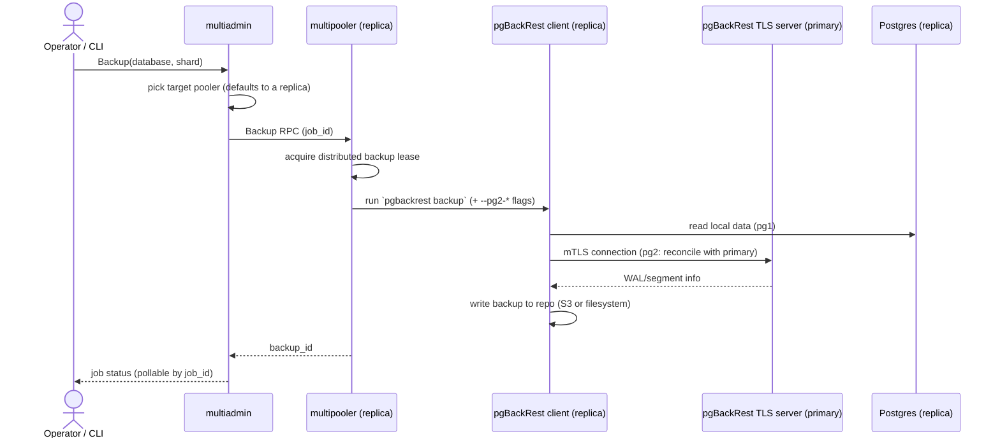

# Backups

This is how Multigres backs up and restores PostgreSQL via pgBackRest: who talks to
whom, what crosses the network, how it's authenticated and encrypted, and
where the safety rails are.

## Request path: multiadmin → multipooler → pgBackRest

`multiadmin` never touches pgBackRest itself; only multipooler (as a
pgBackRest client) and pgctld (running `pgbackrest server`, see
[TLS server setup](#tls-server-setup)) invoke the pgBackRest binary directly.
`multiadmin` is a thin, stateless API gateway: it picks which pooler should
run the backup, hands that pooler an RPC, and tracks the resulting job ID so
it can be polled later (multiadmin keeps no durable state of its own, so a
restart just means it re-asks the pooler for status by job ID).

The interesting case is backing up a **replica**: pgBackRest still needs to
talk to the shard's primary to reconcile WAL, so the replica's multipooler
also opens a connection to the primary's own pgBackRest, over TLS rather than
plain Postgres, as shown below.

The replica-to-primary hop is the only backup-time network path that crosses
pooler boundaries, and it's mutually authenticated TLS (see
[TLS server setup](#tls-server-setup)), not a bare Postgres replication
connection. Everything else (multiadmin to pooler, pooler to pgBackRest,
pgBackRest to repo) is either local IPC/CLI invocation or your configured
object-storage (e.g. S3) credentials.

## Backup and restore in cluster bootstrap

There's no "empty shard" state in Multigres: every pooler in a new shard
does run `initdb` and start Postgres locally, but that local instance is
never what ends up serving traffic. Only one pooler (decided by a
distributed lease, so it's safe if several start at once) is allowed to turn
its local instance into the shard's first backup. Every pooler, including
that winner, then wipes its own local data directory and restores from that
shared backup, so every replica (and eventually the primary) boots from one
common backup rather than N independently-initialized Postgres instances.

### The multipooler auto-restore loop

Each multipooler runs a monitor loop that watches whether its local Postgres
is running. If it isn't, and there's genuinely no data directory (not just
an empty folder, it checks for Postgres's own version marker file) but a
completed backup exists, the loop restores from the latest backup and starts
Postgres as a standby. If there's no data directory _and_ no backup yet, it
falls into the bootstrap race described above.

## Configuration: two config files, and why `pg2` isn't in either

Multigres generates pgBackRest's config from templates rather than letting
an operator hand-write it, and splits it into two files with different
owners and different trust levels:

| Config                     | Owner       | Purpose                                      | Contains secrets?                                             |
| -------------------------- | ----------- | -------------------------------------------- | ------------------------------------------------------------- |
| `pgbackrest.conf` (client) | multipooler | runs `backup` / `restore` / `info`           | yes: repo credentials, cipher passphrases (mode `0600`)       |
| `pgbackrest-server.conf`   | pgctld      | runs the TLS server other poolers connect to | no: only the paths of the TLS cert/key/CA files (mode `0644`) |

Both live in `<pooler-dir>/pgbackrest/` and are rendered from the templates in
`config/pgbackrest/` by `go/common/backup` (`WriteClientConfig`,
`WriteServerConfig`).

Both are static per-pooler except for one thing: **`pg2-*` is never written
into a config file at all.** pgBackRest's `pg2` settings point at a second
Postgres instance, used when backing up a replica, since pgBackRest needs
to reconcile against the primary. Which host counts as "pg2" is different
for every single backup invocation (it's always "whichever pooler is
currently primary," and that changes across failovers), so baking it into a
static file would go stale. Instead, the multipooler resolves the current
primary from topology at the moment a backup starts and passes it as
`--pg2-*` **command-line flags** on that one `pgbackrest backup` invocation.

### pg1 and pg2

`pg1` and `pg2` have fixed, asymmetric meanings that are worth keeping
straight:

#### pg1 = "me" or "self"

`pg1-*` (the settings that _are_ in `pgbackrest.conf`) always means "this
pooler's own local Postgres": self-referential, whether that pooler happens
to be the primary or a replica.

#### pg2 = the primary

`pg2`, whenever it's present, always and only means the shard's current
primary, never "some other replica," and never anything resolved relative
to who's asking. So on a replica, pg1 is "me/self" and pg2 is "the primary
I need to reconcile against." On the primary, there is no pg2 at all,
because pg1 already is the primary.

#### Primary vs. replica backups

Concretely:

- Backing up the **primary**: no `pg2` flags at all, since it's a local
  backup. This is the exception rather than the default (see
  [Ongoing backups](#ongoing-backups-default-to-replicas)
  below); it's what happens during bootstrap and for any explicitly forced
  primary-side backup.
- Backing up a **replica** (the normal case): `--pg2-host-type=tls`, plus
  host/port/path and cert/key/CA flags pointing at the primary's pgBackRest
  TLS server (see below). Nothing touches Postgres's own replication port.
  If the replica's multipooler has no pgBackRest TLS cert/key/CA configured,
  it falls back to a non-TLS mode meant for tests: `--pg2-host`, `--pg2-port`
  (the primary's Postgres port) and a `--pg2-path` that the caller must supply
  as an override (`GetPrimaryAsPg2Args` in
  `go/services/multipooler/internal/manager/rpc_backup.go`).

### TLS server setup

Every pooler also runs a `pgbackrest server` process (started and owned by
**pgctld**, since pgctld already owns the Postgres process lifecycle) that
listens for exactly this kind of cross-pooler request. It's configured for
**mutual TLS**: the server presents a cert/key and validates the client's
cert against a CA file, and the client (the requesting replica) does the
same in reverse: both sides authenticate. Cert/key/CA material is expected
to already be provisioned (e.g. mounted from a secret store); Multigres
doesn't generate certificates itself.

The server is opt-in: `pgctld server` writes `pgbackrest-server.conf` and
starts `pgbackrest server` only when `--pgbackrest-port` and
`--pgbackrest-cert-dir` are both set (setting only one logs a warning and
leaves it disabled). The cert directory must contain `ca.crt`,
`pgbackrest.crt` and `pgbackrest.key`. pgctld restarts the server if it exits
and reports its health through the `pgbackrest.server.up`,
`pgbackrest.server.restart_count` and `pgbackrest.server.uptime` metrics.

## WAL archiving

The primary's `archive_command` is `pgbackrest archive-push`, rendered with
`archive-async=y` for every repository count. In synchronous mode each WAL
segment costs a full process start, config load, repo connection and
`archive.info` read, and pgBackRest cannot push more than one segment per
invocation, so `[global:archive-push] process-max` buys no parallelism
there. In asynchronous mode the first invocation forks one detached
archive-push process that drains `pg_wal/archive_status` in parallel over a
reused connection, and every later invocation just looks for that process's
acknowledgement. With more than one repository async is also what keeps a
down repository from holding the healthy ones one segment behind.

What this does and does not change for durability:

- postgres is only told a segment is archived once the async process has
  written it to the repository and left a `<segment>.ok` file in the spool.
  WAL stays in `pg_wal` until then; a storage outage shows up as
  `archive_command` failures and a growing `archive_status` backlog, exactly
  as before, and archiving resumes on its own when storage recovers.
- `archive-push-queue-max` is deliberately unset. With a limit pgBackRest
  acknowledges and drops WAL once the backlog exceeds it, which silently
  breaks PITR. The trade-off is unchanged from synchronous mode: if the
  repository stays unreachable, WAL fills the primary's disk.
- `spool-path` (`<pooler-dir>/pgbackrest/spool`) holds those tiny ack files
  for archive-push and up to `archive-get-queue-max` (128MiB) of prefetched
  WAL for archive-get. It needs no extra provisioning. pgBackRest prunes an
  ack only when a later async run finds no matching `.ready` file, and it
  trusts any ack it finds, so the spool must not survive a restart of the
  host's WAL history: timeline IDs keep segment names unique within one
  cluster, but a fresh `initdb` against a fresh repository in a reused
  pooler directory could recycle a same-named segment that never reached
  the repository. Nothing clears the spool today.
- archive-push runs as the postgres OS user and now writes to `spool-path`
  and takes a lock in `lock-path`, both created by multipooler. That works
  because multipooler and postgres share a uid (postgres already has to read
  the 0600 `pgbackrest.conf`). A uid split fails loudly: the foreground
  archive-push reports the permission error in the postgres log, and the
  bootstrap-time `pgbackrest check` aborts cluster creation.
- `archive-async` also applies to `restore_command` (`archive-get`): a
  standby catching up from the archive prefetches segments into the spool.
  Its prefetcher detaches from the restore-wrapper's process group, so
  `StopRestoreCommand` may leave it running until its queue is filled; it
  only writes to the spool and never into `pg_wal`, and if it still holds
  the archive lock when the node is promoted, the first async archive-push
  waits it out (bounded by one prefetch batch) and postgres retries.

`[global:archive-push] process-max` now matters: in synchronous mode it was
inert, in asynchronous mode it is the number of segments pushed in
parallel. It is fixed at 2 for now: the other process-max values are derived
from `runtime.NumCPU()`, the node's CPU count, and a small pod on a large
node must not fan out compression across node-sized parallelism. Tuning it
from measurements is a follow-up.

### Rolling out and rolling back

The change is in the rendered `pgbackrest.conf`, which multipooler writes at
startup; a restart of multipooler on each pod is enough, and postgres picks
up the new mode on its next `archive_command` invocation. After rollout,
watch `pg_stat_archiver` (`failed_count`, `last_failed_wal`) and the
`archive_status` backlog on the primary, and check
`<pooler-dir>/pgbackrest/log/multigres-archive-push-async.log` exists. To
roll back, deploy the previous multipooler image and restart it: the conf is
re-rendered with `archive-async=n`, in-flight async pushes finish or are
retried by postgres, and nothing in the repository or WAL changes shape.

## Ongoing backups default to replicas

Ad hoc and scheduled backups both go through the same path: the `multigres`
CLI is just another client of the same `multiadmin` request path shown
above; there's no separate CLI-to-pooler shortcut.

Multigres actively avoids putting backup load on the primary: multiadmin's
pooler-selection logic prefers a replica, and even if a caller pointed a
backup request directly at the primary pooler, it would refuse the request
unless explicitly told to force it. This is a deliberate operational
choice, since backups are I/O and CPU work you generally don't want
competing with production writes. Forcing a primary-side backup is
supported (e.g. single-node shards with no replica yet, or during
bootstrap) but is the exception, not the default.

A static leader (Minigres) is the exception to the exception: it is the only
pooler of its shard, so it backs itself up without being forced, multiadmin
sends its shard's backup operations to it, and it takes no etcd backup lease.
It publishes this as `leadership_mode: LEADERSHIP_MODE_STATIC` in its topology
record. See [Minigres](minigres.md#backups).

## Encryption

Multigres relies entirely on pgBackRest's own repository encryption
(AES-256-CBC); there is no additional Multigres-side encryption layer on
top. What Multigres owns is passphrase lifecycle: cipher passphrases are
supplied via a mounted secrets file, keyed by repository "generation" (so
rotating to a new repo/cipher doesn't invalidate old backups). Because
pgBackRest fixes a repo's cipher permanently the moment it's created,
Multigres checks up front that a usable passphrase exists before that
point, and only ever records/logs a fingerprint of the passphrase, never
the passphrase itself.

In production environments, the pgBackRest repository typically resides
in an object store, such as AWS S3. These tend to provide encryption at
rest for further security.

## S3 endpoint verification

pgBackRest verifies the S3 endpoint's TLS certificate against the system
trust store. Two fields of the S3 backup location change that, and each
pgbackrestd is started with the matching flag:

| Location field    | pgbackrestd flag       | pgBackRest option              |
| ----------------- | ---------------------- | ------------------------------ |
| `ca_file`         | `--s3-ca-file`         | `repoN-storage-ca-file=<file>` |
| `skip_tls_verify` | `--s3-skip-tls-verify` | `repoN-storage-verify-tls=n`   |

`ca_file` is a PEM file of the certificate authorities that verify the
endpoint, for a self-hosted S3 service behind a private CA. It may hold
several certificates, and a self-signed server certificate works as its own
CA. The sidecar requires an absolute path that is outside the data volume
after symbolic links are resolved and a regular file that holds a
certificate, and adds read access to that one file for the pgBackRest
commands that open the repository. That is a statement about the added
access only: every pgBackRest command can already read `/etc` and the system
trust stores, so a CA file kept there is readable by all of them. pgBackRest
reads the file for every command, so new
content at the same path applies from the next command on. To rotate the
CA, put the old and the new one in the file, switch the endpoint's
certificate, then remove the old one: a command that started before a change
keeps the file it read, and fails and is retried if the endpoint's
certificate stops matching it.

OpenSSL finds a trust anchor by subject name. If the file holds two
self-signed certificates with the same subject and no key identifiers (an old
and a new server certificate, both `CN=s3.internal.example`), only the first
is tried, so put the one in use first.

`skip_tls_verify` turns verification off. It is never set implicitly and
cannot be combined with `ca_file`. A sidecar started with it:

- logs a warning (`TLS certificate verification of the S3 endpoint is OFF`)
  when it starts and for every Configure it applies,
- reports `s3_tls_verify_disabled: true` in its `Status` response,
- exports the gauge `pgbackrest.s3.tls_verify_disabled` with value 1.

Both settings are part of the location fingerprint that multipooler compares
with its sidecar's: a sidecar that verifies differently from the topology's
backup location is refused until it is restarted with matching flags. That
holds for a sidecar restarted on its own while multipooler keeps running: it
does not load the configuration an instance with other settings saved, it
refuses a Configure that names another fingerprint, and multipooler does not
configure it, so it archives nothing until its flags match again. They
are not part of the repository's identity, so changing the CA of an existing
repository does not make it a different repository.

### Changing a location setting

To change the CA file path or the verification setting of a running shard,
change the database record's backup location and restart each sidecar with
the matching flags, in either order:

- A sidecar restarted first reports a fingerprint the record does not name.
  Multipooler reads the record again on every sync pass (10 seconds) and
  leaves the sidecar unconfigured until the record names what the sidecar
  serves. It then configures the sidecar without being restarted. WAL queues
  in postgres meanwhile.
- A multipooler that starts while its sidecar still runs with the old
  settings does not become ready and does not start postgres. It reads the
  record and the sidecar again every sync interval, and exits with
  `pgbackrest sidecar location does not match topology` if they still differ
  when its topology load timeout ends.

Changing the record alone stops nothing: a multipooler and a sidecar that both
run with the old settings keep archiving with them until the sidecar is
restarted.

### A sidecar that stays unconfigured

A sidecar that does not load its saved configuration (it was saved under
another fingerprint, by a build that recorded none, or the file is damaged)
moves the file to `state/generations.json.bad*`, logs
`persisted generations could not be loaded`, reports the reason as
`state_error` in `Status`, and waits for multipooler's Configure. It refuses
any revision below the one the file held. Multipooler and pgbackrestd must be
the same build: the sidecar refuses a Configure that names no fingerprint.

The first start after an upgrade from a build whose saved configuration has no
fingerprint takes this path once per pod. The sidecar offers the list from the
file it set aside (`set_aside_repos` in `Status`) and multipooler sends it
back at the same revision, so the sidecar is configured within one sync
interval and needs no database for it.

If the file is damaged the sidecar has no list to offer, and multipooler's
copy on the data volume may be older than the revision the sidecar refuses
below. Multipooler then logs `pgbackrest sidecar is not configured and refused
this pooler's copy of the generation list` with both revisions. It resolves on
its own once multipooler can read that revision from the generation table,
which needs postgres on that pod to answer queries. A standby that cannot
start without WAL from the archive never gets there. To recover it, remove
`generations.json.bad*` from that sidecar's state directory and restart the
sidecar: with no revision to refuse below, it accepts multipooler's copy. That
is safe while the copy's list is current, which it always is while only the
initial repository generation exists.

For the local provisioner, see
[Self-hosted S3](../local-cluster.md#self-hosted-s3).

## No in-place restores

Restore is guarded so it can only run against a data directory that is
genuinely empty or absent, not stopped-but-populated, not corrupted, just
gone. Attempting to restore over an existing data directory fails outright
rather than overwriting anything. Restore is also refused on a pooler that's
currently the primary.

Combined with there being no operator-facing restore RPC (see the
auto-restore loop above), this means restore in Multigres exists for exactly
one purpose: bringing up a new (or being-rebuilt) replica from a known-good
backup. It is intentionally **not** a disaster-recovery "restore on top of
a live primary" tool, and not a point-in-time-recovery workflow against an
existing cluster.
