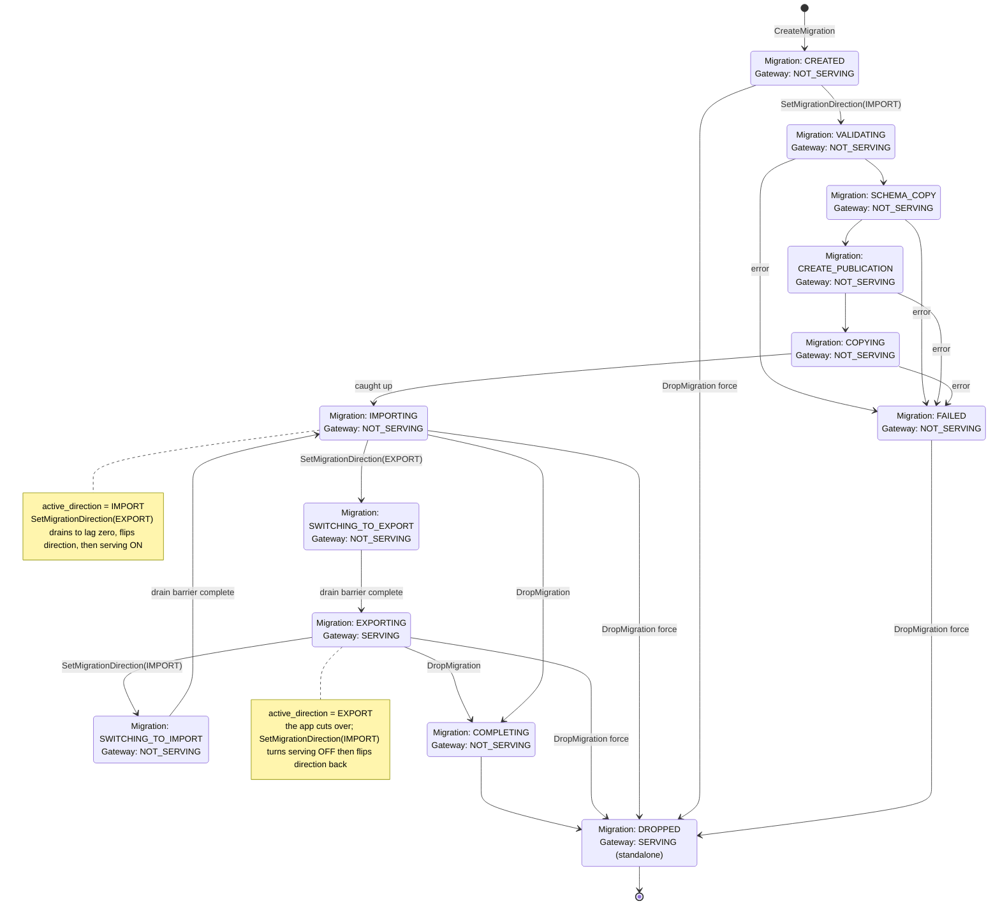
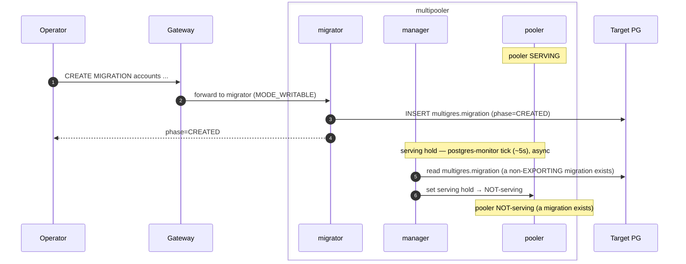
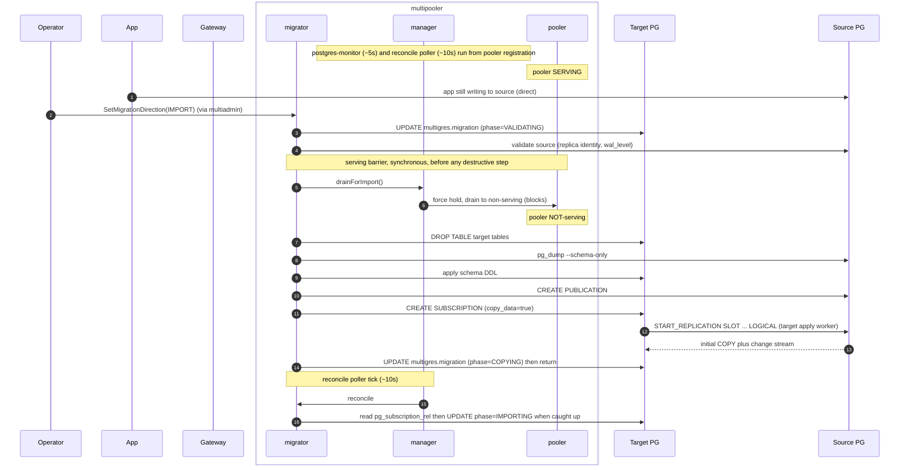
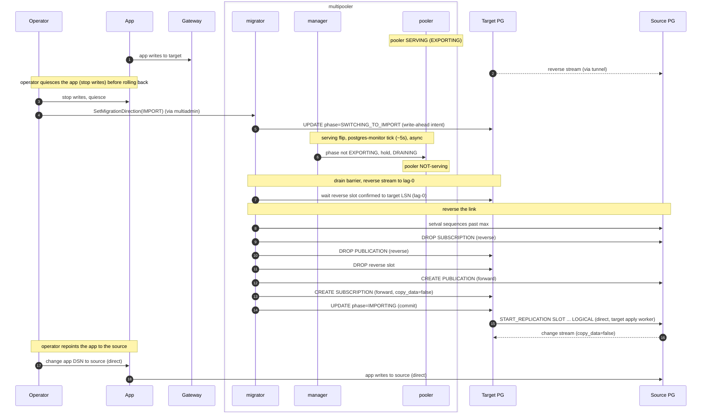
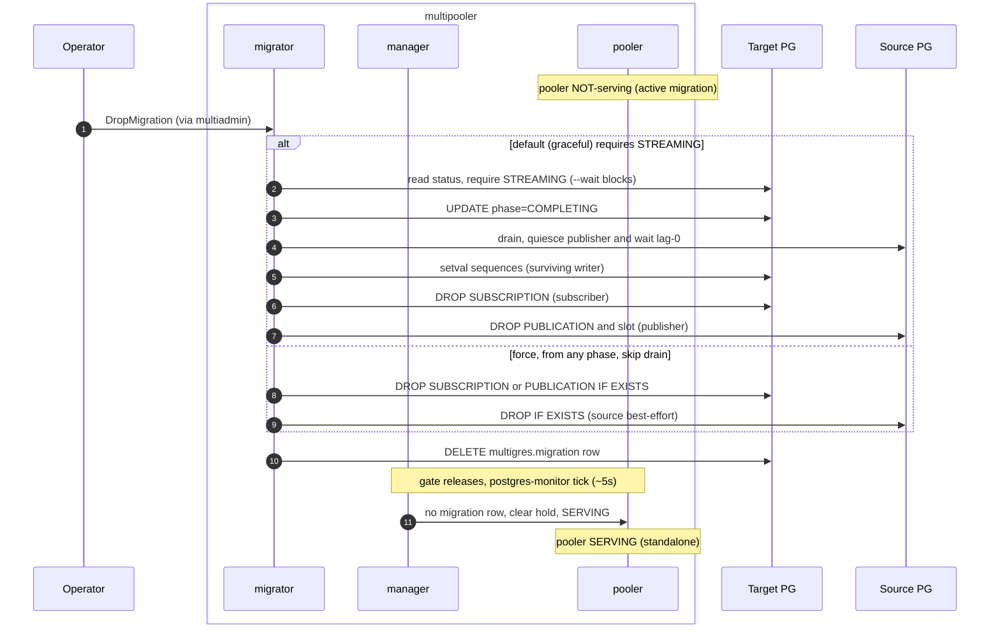
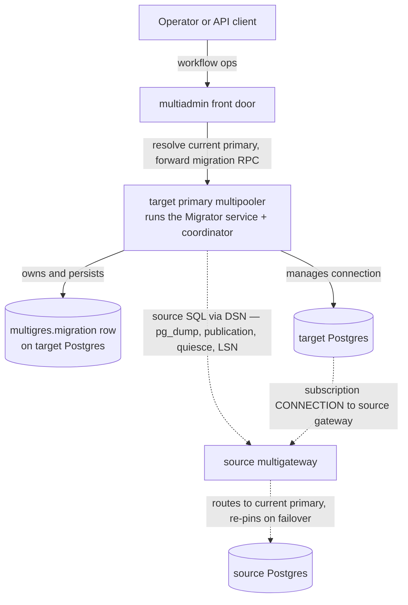
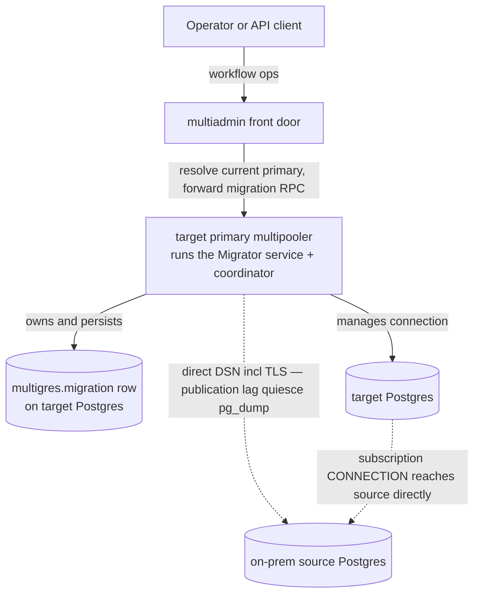
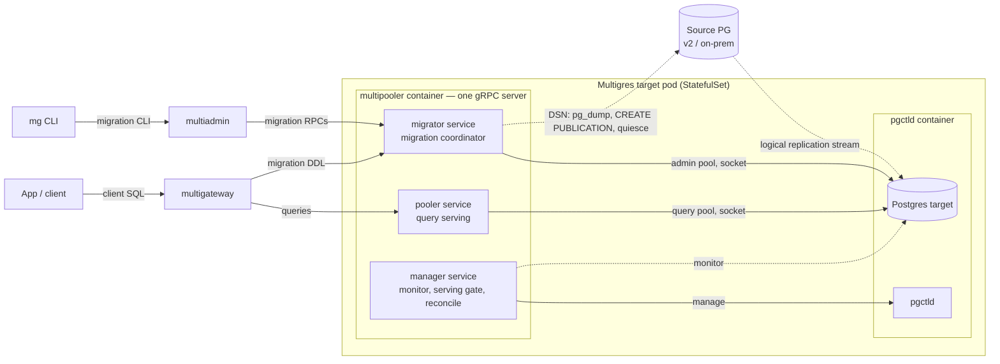
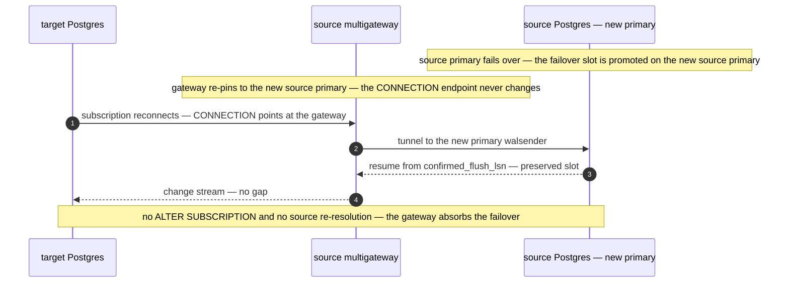
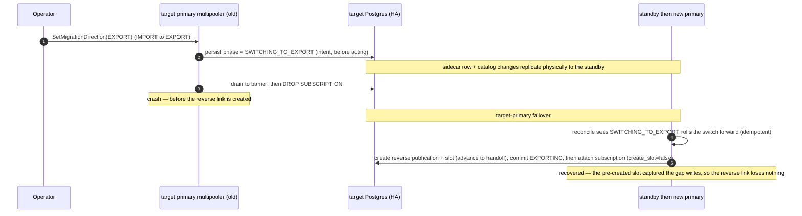

# Multigres Migrator: table-migration coordinator via logical replication

> **Name.** This feature is the **Multigres Migrator**. There is no separate binary, process, or topo type: it is a
> gRPC service (`Migrator`, `proto/migratorservice.proto`) registered directly on multipooler's existing gRPC server
> (`grpcmigrationservice.RegisterMigrationServices`) and driven by the migration coordinator package
> (`go/services/multipooler/internal/migration`) that runs inside the shard's current primary multipooler.

## Overview

Multigres needs a first-class tool to **move tables from one shard to another**, and to **onboard an on-prem Postgres
database into a multigres cluster** with minimal setup for the on-prem operator. Today none of this exists: the codebase
has physical-replication/consensus primitives and a gateway-side logical-replication tunnel, but no
publication/subscription-driven table-migration mechanism and no migration workflow object.

This document describes _Multigres Migrator_: a shard-scoped coordinator, running inside each shard's multipooler
process, that drives a single logical-replication stream per migration. It connects to the source using a plain DSN,
so it can connect to any Postgres source reachable by a standard connection string.

Multiadmin is a thin front door that resolves the target shard's current primary multipooler and forwards the
operator's commands to its migration RPCs. The workflow runs through catch-up and a symmetric direction switch (a
data-consistency barrier plus a reverse stream that flips whichever direction is active, so re-running it is the
undo).

## Background

Multigres Migrator builds on stock [Postgres logical
replication](https://www.postgresql.org/docs/current/logical-replication.html) rather than an owned change-capture/apply-loop
component. The rest of this document covers how the feature actually works: the prototype that validated the approach, the
Postgres behaviors the design accounts for, and why replication slots — not the control plane — hold the replication state.

### Prototype

The prototype validated the single-stream happy path end-to-end:

1. copy schema (`pg_dump --schema-only`)
2. create publication
3. create subscription (initial `COPY` plus stream)
4. wait for catch-up
5. quiesce plus advance sequences plus flip direction
6. teardown

The run was validated with a no-data-loss demonstration under concurrent insert/update/delete load, verified by
full-table identity (row count plus content checksum) between source and target.

### Postgres behaviors the design accounts for

These are behaviors of Postgres logical replication that the coordinator works with internally — implementation
concerns, not settings the operator configures or requirements the migrated application must meet:

- **Autocommit is used for the control**: `CREATE`/`DROP SUBSCRIPTION` cannot run inside a transaction block. Since this
  is for the administrative connection, it does not affect the application.
- **DDL is not replicated**: the target schema must exist before subscribing. The schema is copied as part of the
  initialization using `pg_dump --schema-only`.
- **Sequences are not replicated**: after a switch the new-source identity counters are still at their start value, so
  it is necessary to call `setval` past the max before that side takes writes.
- **Subscription `CONNECTION` is target-evaluated**: the conninfo must be usable by the target's Postgres to reach the
  source, and it must remain valid across a source-primary failover.
- **A switch needs a quiesce plus lag-zero barrier** so both sides are byte-identical at a known LSN, which makes the
  reverse subscription safe with `copy_data=false`.

### Replication slots

A migration hinges on a **logical replication slot** on the source, so it is worth being precise about what a slot is
and why its state cannot be checkpointed anywhere except the Postgres server that owns it.

A logical replication slot is a small piece of durable server state that maintains two invariants against that specific
Postgres instance:

- **`restart_lsn`** — the oldest WAL the slot might still need. As long as the slot exists, the server **must not
  recycle WAL** at or after `restart_lsn`. This is what guarantees the change stream can resume without gaps.
- **`catalog_xmin`** — the oldest transaction id whose catalog rows must be retained. As long as the slot exists,
  **`VACUUM` must not remove catalog tuples** newer than `catalog_xmin`, because logical decoding needs the historical
  catalog to interpret WAL records (which column types/names were in effect at the time). This is what guarantees WAL
  from `restart_lsn` onward is still _decodable_.

Both values are established when the slot is created and both only ever move **forward** as the consumer confirms
progress. A slot is therefore a live reservation over the retained WAL and a held-back catalog horizon that exist only
inside one Postgres instance.

In contrast to MySQL, there are restrictions on what you can do with a slot:

- You can create a slot using `pg_create_logical_replication_slot()` or over the walsender protocol. The walsender form
  can additionally export a snapshot aligned exactly to the consistent point of a slot. Creation has **no LSN or xmin
  parameter**: you get the consistent point the server computes, never one you choose.
- You can advance a slot **forward only** using `pg_replication_slot_advance()` to skip changes you don't need. It
  **cannot move backward**.
- You can inspect the state of slots using `pg_replication_slots` and `pg_stat_replication_slots` views, but you cannot
  change the values of any slots.
- You can consume or peek at the contents of a slot using `pg_logical_slot_get_changes` or
  `pg_logical_slot_peek_changes` functions. You can also start streaming changes through the walsender protocol.
- You can copy a slot using `pg_copy_logical_replication_slot()`, which duplicates an existing slot position, but only
  within the same instance.
- You can drop a slot using `pg_drop_replication_slot()`, which releases the retained WAL and the catalog-xmin hold.
- You can also set up slots to be synchronized with the standbys by setting the `failover` option; the slot-sync worker
  then mirrors the slot to the physical standbys, letting it survive a promotion.

In particular, there are a few things that you cannot do:

- There is no API to construct a slot at a chosen position. You have to create the slot before any activity that you
  need to replicate.
- There is no API to read the internal state of a slot, persist it elsewhere, and later recreate the slot at that state.
  (But you can copy a slot locally.)
- `pg_replication_slot_advance` is **forward-only**, so you cannot create-then-rewind to a saved position either.

There is a good reason for this. The values in `pg_replication_slots` are not the actual state; they are just _pointers
into_ a state that exists only on the owning server, which is simultaneously retaining the WAL from `restart_lsn` and
holding back `VACUUM` at `catalog_xmin` so the events in the WAL remain decodable. If you copied those values into topo,
a control-plane database, or a file, that copy would be inert: dropping the slot releases the reservation, so by the
time you tried to use the copy the server may have recycled the WAL and vacuumed away the catalog rows the values point
at — and there is no API that accepts those values to reconstruct a slot in any case (creation always starts a fresh
consistent point). The reservation and the thing reserved are inseparable, and both live inside one Postgres instance
and its physical replicas.

As a consequence, and in contrast to VReplication, the Multigres Migrator never stashes slot positions in the control
plane and reinstates them. Source-shard failover safety rests entirely on Postgres features and a lost or dropped slot
means re-establishing the stream from scratch. This is why the design leans on failover slots plus the quiesce+lag-zero
barrier, and never on saving and restoring slot state.

## Design decisions

1. **Multigres Migrator is a shard-scoped service** — one instance per shard / storage cluster, deployed as its own
   Deployment, **not** a per-pod sidecar. It is decoupled from any single Postgres process, so a primary failover inside
   a shard does not strand a migration.
2. **Multigres Migrator drives the target through the target shard's primary multipooler**, calling new migration RPCs
   on it. Multigres Migrator resolves the current primary from topo (and watches for changes), so failover is handled by
   re-targeting the new primary — reusing multipooler's connection management, replication-connection primitive, and
   leader-election signals rather than pinning to a backend.
3. **The source is always reached by a DSN, stored in a separate, named Connection.** A `Connection`
   (`multigres.connections` on the catalog shard — created with `CREATE CONNECTION <name> ...` over gateway SQL, or
   `CreateConnectionRequest` over gRPC) holds the source DSN; a migration references one by name
   (`connection_name`/`--connection`) rather than supplying source details itself, so the same Connection is reusable
   across migrations and can be replaced by pointing
   a migration at a newly-created one. For a **multigres-shard source** the stored DSN targets that shard's **gateway**,
   which routes to the current source primary and re-pins across a source-primary failover; for an **on-prem/standalone
   Postgres** (no shard/pooler) the DSN connects directly (incl. TLS) — the "logical replication between non-multinode
   instances" path. Either way the coordinator never resolves or re-points the source primary itself, so a source
   failover needs no `ALTER SUBSCRIPTION ... CONNECTION`. The connection records an `owner_role` (the gateway
   SQL-authenticated role that created it); enforcing that ownership against the migrations that reference it is a
   separate, still-landing piece of work, not yet wired up.
4. **multiadmin is a thin user-facing front door** that forwards operator operations to the owning (target-shard)
   Multigres Migrator; it holds no workflow state and runs no phase engine.
5. **Scope = stream + observe + a symmetric direction switch that gates serving**: quiesce → drain-to-lag-zero → journal
   handoff LSNs → `setval` sequences on the new source → tear down the current path → establish the reverse path
   (`copy_data=false`) → flip serving. One operator verb, `set-migration-direction` (EXPORT = go live, IMPORT = roll
   back), drives the one symmetric flip, so "undo" is just calling it again with the other direction. The target does
   not serve client queries until the switch to EXPORT (see _[Serving gate](#serving-gate)_). `pause`/`resume` and
   failure-resume are deferred (Roadmap).
6. **`copy_data` is optional** at subscription setup — create a subscription without the initial copy so data can be
   seeded by other means. Shipped with documentation on how to use it.
7. **The source connection supports the full range of Postgres connection options, including TLS/encryption** (`sslmode`
   up to `verify-full`, client certs, etc.).
8. **Publication creation is unconditional today**: Multigres Migrator always creates the source publication itself;
   there is no option yet to skip it for a pre-created one.
9. **Migration validation checks replica identity** at create/start time: reject tables with no usable replica identity
   for `UPDATE`/`DELETE`; warn when a table uses `REPLICA IDENTITY FULL` (works, but expensive). Selection is
   whole-table/whole-schema only today (see _[Options](#options-for-create-migration)_ and _Roadmap_); once row/column
   filtering ships, the same validation will need to extend to checking that every filter column is covered by the
   replica identity, since a publication replicating `UPDATE`/`DELETE` can only filter on replica-identity columns.
10. Excludes gateway **query/traffic routing** and **VDiff** — both shipped with documentation describing what they
    require and the manual options today.

## Migration lifecycle

Single state machine. The migration record lives in a `multigres.migration` row on the target Postgres itself
(`go/services/multipooler/internal/migration/store.go`), reconciled by the migration coordinator running inside the
shard's current primary multipooler. It tracks an `active_direction` (which side is currently the publisher); one RPC,
`SetMigrationDirection(ref, direction)`, sets it. **The target shard's serving state follows `active_direction`:
while IMPORT (Multigres is the subscriber being populated) the shard does not serve client queries; switching to EXPORT
is what turns it into a live, serving server** (see _[Serving gate](#serving-gate)_). "Source-side work" below is the
source-side SQL — executed over a DSN to the source shard's gateway (multigres source) or directly to the server
(non-multigres source).

The workflow at a glance, with each state's serving status annotated (`IMPORTING` and `EXPORTING` are the steady-state
streaming phase in the IMPORT and EXPORT directions):



- **`CREATED`** — `create-migration` records config as a row in `multigres.migration` on the target only, no other
  database changes. Stage/validate before touching either DB.
- **`VALIDATING`** — on the first `set-migration-direction --direction=import` call (there is no separate start
  verb — setting IMPORT on a migration still short of `COPYING` is what runs the setup pipeline): source/target
  reachable, tables exist, source `wal_level=logical`, and each table has a usable replica identity — reject a table
  with no PK/unique index and no explicit replica identity; warn on `REPLICA IDENTITY FULL`.
- **`SCHEMA_COPY`** — ensure target tables exist: first **drop the migrated tables on the target** (`DROP TABLE IF
EXISTS … CASCADE`) so a pre-existing table (a re-run after a partial migration, or a target that already had them)
  does not fail the apply with "relation already exists"; then `pg_dump --schema-only` of the named tables from the
  source, applied on the target (psql backslash meta-lines stripped). Skippable (`--skip-schema-copy`), which also skips
  the drop — that path keeps a target seeded out-of-band.
- **`CREATE_PUBLICATION`** — `CREATE PUBLICATION` on the source `FOR TABLE <tables>` (plus optional `WHERE`/column
  list). Skipped if publication pre-created.
- **`COPYING`** — `CREATE SUBSCRIPTION` on the target. `copy_data` optional: `true` = stock tablesync initial `COPY`;
  `false` = no copy (seeded out-of-band). If copying, poll `pg_subscription_rel.srsubstate` until all `r`.
- **`IMPORTING`** — the steady-state streaming phase in the IMPORT direction (`active_direction = IMPORT`); report lag
  from the source's `pg_stat_replication`. **The target does not serve client queries in this state** (see _[Serving
  gate](#serving-gate)_) even once caught up — going live is the explicit switch to EXPORT, not a side effect of
  catching up.
- **`IMPORTING` ⇄ `EXPORTING`** (operator: `set-migration-direction --direction=export` / `--direction=import`) —
  the switch passes through a transient phase, `SWITCHING_TO_EXPORT` (`IMPORTING`→`EXPORTING`) or
  `SWITCHING_TO_IMPORT` (`EXPORTING`→`IMPORTING`), while it flips the active direction and, with it, serving: 1)
  quiesce current source; 2) drain to lag zero; 3) journal a handoff entry (drained-to LSN, new-source LSN, direction,
  timestamp); 4) `setval` new-source sequences past max; 5) drop current sub (drops slot) plus publication; 6)
  establish reverse path (`CREATE PUBLICATION` on new source, `CREATE SUBSCRIPTION` with `copy_data=false` on new
  target); 7) re-enable writes on new source; flip `active_direction` and leave `SWITCHING_TO_*`. Switching to EXPORT
  (`SWITCHING_TO_EXPORT`→`EXPORTING`) turns serving **on** only after the drain barrier (step 2) confirms the target
  has every event; switching to IMPORT (`EXPORTING`→`SWITCHING_TO_IMPORT`) turns serving **off** first, then drains
  back.
- **`DROPPED` / `FAILED`** — `drop-migration` drops sub/pub/slot idempotently on both sides and deletes the migration
  row; journal retained for audit. The default drop first passes through a transient `COMPLETING` phase, a
  **quiesce+drain barrier** so no in-flight change is lost: it requires the migration to be caught up
  (`IMPORTING`/`EXPORTING`), sets the current source read-only, waits for the target to reach the source's LSN,
  advances the new writer's sequences, and only then tears down to `DROPPED` — leaving the shard standalone and
  write-safe. A crash mid-`COMPLETING` resumes the same teardown on restart rather than reverting. `--wait` first
  blocks until the migration catches up (bounding the read-only window), then runs the same barrier. `--force` skips
  the whole barrier (no quiesce, no drain, no sequence advance, no `COMPLETING`) and removes the migration from any
  phase directly — the abandon path, which can leave an incompletely-copied or PK-unsafe target. A default drop is
  thus safe from either `IMPORTING` (source frozen read-only, a one-way cutover) or `EXPORTING`; only a not-caught-up
  or never-started migration needs `--wait` or `--force`.

Notes:

- **One symmetric primitive, one verb.** `SetMigrationDirection(ref, direction)` is the only operator verb for every
  direction change: the first call (`IMPORT`, from `CREATED`) begins the migration's pipeline, a later `EXPORT` call is
  the cutover, and a later `IMPORT` call is the rollback — same symmetric flip with an explicit target each time.
  Setting the direction the migration is already in is a no-op (not an error): calling `EXPORT` on an already-EXPORTING
  migration, or `IMPORT` on an already-IMPORTING one, just returns the current status, so "undo" is simply calling it
  again with the other direction and there is nothing to guard against re-issuing the same call twice. Each flip relies
  on the quiesce+lag-zero barrier making both sides identical, so `copy_data=false` is always safe. (`active_direction`
  stays IMPORT/EXPORT in the record and status views, matching the direction values the one verb takes.)
- **The source quiesce at the cutover to EXPORT is a hard barrier, not just read-only.**
  `default_transaction_read_only` alone is not airtight: it only defaults _new_ transactions, an in-flight transaction
  still commits, and a client can override it (`BEGIN … READ WRITE`, `SET … = off`). Because the source becomes a
  subscriber, any write it takes after the barrier is captured by nothing and diverges (logical replication never
  reconciles a local write on a subscriber). So switching to EXPORT quiesces the source hard, in this order: (1)
  `default_transaction_read_only = on` cluster-wide to freeze anything still connected; (2) `pg_terminate_backend`
  every remaining `client backend` (never walsenders/apply workers, never the migrator's connections, which carry a
  distinct `application_name`); only then (3) capture the barrier LSN and wait for `confirmed_flush ≥ LSN`.
  Terminating (rather than only blocking) is what makes the captured LSN final. This leaves one residual gap: a
  reconnecting client is only _defaulted_ to read-only, not barred from explicitly overriding it (`BEGIN … READ
WRITE`, `SET … = off`). Closing that — revoking `CONNECT` from named, operator-specified source application
  role(s) so they cannot reconnect at all — is planned (Roadmap) but not implemented yet; the `quiesce_roles` field
  already accepted by `CreateMigrationRequest`/`CREATE MIGRATION ... WITH (quiesce_roles = ...)` is not yet read or
  enforced by the coordinator.
  The cluster-wide read-only barrier stays up through the switch itself — the switch's own catalog work (e.g.
  `DROP PUBLICATION`) uses only a session-local override, not a full un-quiesce — and only lifts once the reverse
  subscription actually attaches on the target side, the first point a source write is safe to let through; lifting it
  any earlier would let a stale client reconnect and commit a write the reverse stream could never capture. Today the
  read-only GUC is what keeps the app out for the rest of the EXPORT lifetime (with the residual gap noted above);
  switching back to IMPORT resets it. Switching back to IMPORT (EXPORT→IMPORT) needs no GUC on the target: the
  target's postgres is reachable only through the pooler, so its hard guarantee is the serving gate — switching to
  IMPORT drains the pooler to non-serving **synchronously** (the same `drainForImport` barrier the initial setup
  pipeline uses) before the target becomes a subscriber, rather than waiting for the async monitor tick. A graceful
  drop keeps the source a standalone primary, so it uses only the soft read-only drain (no terminate, no CONNECT
  fence).
- **Why the reverse path is built at switch time, not pre-armed.** A tempting alternative is to create the subscriptions
  and publications for _both_ directions up front and just `ENABLE`/`DISABLE` them at the switch. This works for
  publications — they are stateless metadata (a table set plus optional filter), hold no slot or position, and drive no
  data until a subscription consumes them, so pre-creating both is free. It does **not** work for the reverse
  **subscription**, because a subscription owns a replication slot on its publisher and a _disabled_ subscription's slot
  still exists but never advances: it pins `restart_lsn` (the publisher must retain all WAL from that point → unbounded
  WAL growth) and holds back `catalog_xmin` (VACUUM cannot reclaim catalog tuples → catalog bloat). The reverse slot
  lives on the migration **target** — the node already absorbing the entire forward stream — so an idle reverse
  subscription would pin every byte of WAL the target produces for the whole migration. It is also the
  [created-but-never-consumed failover slot](https://www.postgresql.org/docs/current/logical-replication-failover.html)
  hazard: an unconsumed slot's frozen `catalog_xmin` makes it look temporary and it is dropped on failover, so
  pre-arming does not even survive the event it exists for. Hence the reverse slot is created at **switch time**, not
  ahead of it — but it must exist a moment _before_ serving turns on, so it captures the writes the app makes to the
  target the instant it can connect (`copy_data=false` can't backfill them). The subscription can't create the slot
  then: its connection dials the target through the gateway, which refuses it until `EXPORTING`. So `switchTo` creates
  the reverse slot explicitly on the target and `pg_replication_slot_advance`s it to the handoff LSN, and the reverse
  subscription attaches with `create_slot = false` once serving is on. The idle window is only the few seconds between
  slot creation and the subscription attaching after the `EXPORTING` commit, so the WAL-pinning cost is negligible.
  `ENABLE`/`DISABLE` is reserved for short-lived pause/resume within the _active_ direction (Roadmap), where the same "a
  long disable re-accumulates WAL" caveat applies. (Both directions _enabled at once_ — active-active via PG16+ `origin
= none` to break the loop — is a different model with concurrent-write conflict handling and is deliberately out of
  scope: the migrator keeps a single writer via the quiesce barrier.)
- MVP = one source → one target, a set of whole tables, single subscription/slot (no chunking; large-table copy uses
  stock tablesync — resumable chunked copy is a Roadmap item).
- **Reverse stream across a major version (rollback to an older source).** A common shape is onboarding an older source
  (PG14 is the floor the migrator supports) onto a newer Multigres target (PG17+) and keeping the reverse stream armed
  so the old server stays a warm rollback. The reverse direction then has a _newer publisher → older subscriber_, which
  stock logical replication supports: negotiation is subscriber-driven (the older subscriber only knows protocol
  versions up to its own, so it requests that and the newer publisher serves it), no new `pgoutput` message types were
  added between PG14 and PG17, and every newer wire feature (parallel-apply protocol v4, binary initial sync, `origin`
  filtering) is gated so an old subscriber never receives it. The constraints to respect: (1) creating the reverse
  **subscription runs on the old server**, so it needs a superuser DSN there when that version predates the
  `pg_create_subscription` role (PG16) — on PG14/PG15 this means IMPORT (the common direction, source as publisher only)
  works with a plain `REPLICATION`-capable role, but arming the reverse EXPORT subscription needs a superuser DSN for
  that source specifically. (2)
  Use the default **text** format, not `binary` — no built-in type's binary `send` format changes across majors, but
  binary demands an exact type match, fails outright for any type the older subscriber lacks a binary `recv` for, and is
  fragile for OID-embedding composite/`record` columns; text is version-robust. (3) Sequences and DDL still do not
  replicate (see the switch's `setval` step) — on an actual failback, advance the old
  server's sequences past max first, and keep schema changes off the tested platform or apply them to both sides, or the
  old subscriber's apply worker stalls. (4) Do not leave both directions streaming at once across versions: the
  loop-breaker (`origin = none`) is PG16+, so a pre-PG16 subscriber cannot suppress echoed changes — keep a single
  active direction (the quiesce+switch model). Parallel apply and binary initial sync are simply unavailable on the old
  side (a degradation, not a failure).
- **Detecting EXPORT-capability on a PG14/PG15 source must not probe for a role that doesn't exist yet.** The
  `pg_create_subscription` role itself is PG16+, and `pg_has_role(current_user, 'pg_create_subscription', 'MEMBER')`
  raises a hard error for a nonexistent role name rather than returning false — so the membership check only runs
  inside a `CASE WHEN server_version_num >= 160000` branch, which Postgres guarantees short-circuits (unlike a plain
  `AND`/`OR`, where evaluation order isn't guaranteed). This is what lets `capabilities()` read version + role info in
  one round-trip against any supported source version without erroring out on PG14/PG15.
- A switch makes the new target correct and write-ready and keeps the new standby (old source) current, so the next
  switch back is always safe. It does not move client writes — that is gateway routing (out of scope).

## Serving gate

A migration exists to move data **into** Multigres, so the target shard must not serve client queries until it holds a
complete, caught-up copy. Serving is therefore gated on `active_direction`:

- **IMPORT — not serving.** From `CREATED` through `IMPORTING` (the streaming phase in the IMPORT direction) the target
  is the subscriber being populated; its pooler advertises a non-serving state, so the shard is not treated as a live
  server — even after it has caught up. The hold starts as soon as a migration **exists** on the shard (`CREATED`), not
  only once it is started, so clients cannot change the database while a migration is staged against it.
- **EXPORT — serving.** `set-migration-direction --direction=export` flips `active_direction` to EXPORT only after the
  drain barrier, and the shard goes live. Going live is the operator's explicit act; catching up alone does not start
  serving.

The application owns the traffic cutover: it stops writing to the source and points at Multigres once the shard is
active. Multigres does not move client traffic itself (that is gateway routing, out of scope).

**What "not serving" means at the gateway.** The gateway picks the routing primary from liveness plus routing role
(consensus/recovery), not from serving status, so a non-serving target still _is_ the routing primary. Marking it
non-serving makes the pooler hold new client work (a buffered-retry signal) and the gateway **buffers** it until
activation — it does not route elsewhere (there is nowhere else: the source is external). In the normal flow the
application is still on the source during IMPORT, so there is nothing to buffer; the gate is the safety net that stops a
stray client from reading a half-copied shard.

**Mechanism (pooler).** The effective serving state is `DRAINING` while an IMPORT migration is active on the shard and
reconciles to `SERVING` when it flips to EXPORT — the same monitor-reconciled path the divergence hold uses, driven by
`active_direction` in the migration record (so it survives a pooler restart and a target failover). `DRAINING`
(transient, monitor-reconcilable) is used rather than `DISABLED` (sticky, reserved for shutdown/demote). The gate
applies to every pooler in the target shard (primary and standbys read the replicated migration record), so a standby
will not serve reads of a half-copied shard either. The initial setup pipeline (the first
`SetMigrationDirection(IMPORT)` call) does not wait for that monitor tick: it drives the pooler to non-serving
**synchronously** (a drain barrier) before it drops the target tables or creates the subscription, so there is no
window in which a client can write to a shard that is about to be overwritten by the initial copy; the monitor then
keeps the hold on every subsequent tick.

## Migrator operation sequences

These sequences trace the **current implementation**: the migrator coordinator, the manager (postgres monitor + serving
gate + reconcile poller), and the query pooler run as services inside a single **multipooler**, with migration state in
the replicated `multigres.migration` table and `multiadmin` forwarding the operator RPCs. There is one diagram per
operator action. A `Note over POOL` on the pooler lifeline marks whether it is SERVING client queries or NOT-serving;
migrator SQL runs on the local Postgres over the admin pool, and the source is reached over its DSN.

### CreateMigration



Creating a migration takes the shard **non-serving**: as soon as the `CREATED` row exists, the ~5s postgres-monitor sees
a non-EXPORTING migration and holds serving, so clients cannot change the database while a migration is staged against
it. The flip is monitor-driven (within one tick); the first `SetMigrationDirection(IMPORT)` call still runs a
synchronous drain barrier before its destructive setup, and if create is followed immediately by it that barrier
guarantees non-serving before any table is dropped. `CREATE MIGRATION` is also drivable via `mg` / multiadmin (the RPC
front door, which works at every phase).

### SetMigrationDirection

`SetMigrationDirection(ref, direction)` is the single operator verb for every direction change — there is no separate
start/activate/deactivate RPC. What it does depends on the migration's current state: a not-yet-started migration
(target `IMPORT`) runs the initial setup pipeline below; a caught-up `IMPORTING` migration (target `EXPORT`) runs the
cutover; a caught-up `EXPORTING` migration (target `IMPORT`) runs the rollback; and setting the direction the migration
is already in is a no-op. The three sequences below show each of those state-dependent behaviors in turn.

#### Initial setup (first `SetMigrationDirection(IMPORT)` call)



The serving flip is synchronous: this call runs the drain barrier before `DROP TABLE` / `CREATE SUBSCRIPTION`.
The pooler is drained and non-serving before streaming begins — there is no window in which a client can write to the
target. The ~5s postgres-monitor only keeps the hold afterward; the ~10s reconcile poller advances `COPYING` →
`IMPORTING` once the copy catches up. Streaming is Postgres-to-Postgres: `CREATE SUBSCRIPTION` starts the target's apply
worker, which issues `START_REPLICATION` to the source walsender — the migrator does not carry the stream.

#### Cutover to EXPORT (`SetMigrationDirection(EXPORT)` from a caught-up `IMPORTING` migration)

```mermaid
sequenceDiagram
    autonumber
    participant OP as Operator
    participant APP as App
    participant GW as Gateway
    box transparent multipooler
        participant MIG as migrator
        participant MGR as manager
        participant POOL as pooler
    end
    participant TGT as Target PG
    participant SRC as Source PG
    Note over POOL: pooler NOT-serving (IMPORTING)
    Note over OP,APP: before the cutover, operator repoints the app to the target
    OP->>APP: change app DSN to target (gateway)
    APP-xGW: connect or write, blocked 57P03 (still IMPORTING)
    OP->>MIG: SetMigrationDirection(EXPORT) (via multiadmin)
    MIG->>TGT: UPDATE phase=SWITCHING_TO_EXPORT (write-ahead intent)
    Note over MIG,SRC: drain barrier, make both sides identical (lag-0)
    MIG->>SRC: quiesce source, SET read-only (cluster-wide)
    MIG->>TGT: wait target consumed to source LSN (lag-0)
    Note over MIG,TGT: reverse the link; source stays read-only cluster-wide throughout
    MIG->>SRC: session-local read-only override (for this connection's own DROP PUBLICATION only)
    MIG->>TGT: setval sequences past max
    MIG->>TGT: DROP SUBSCRIPTION (forward)
    MIG->>SRC: DROP PUBLICATION (forward)
    MIG->>TGT: CREATE PUBLICATION (reverse)
    MIG->>TGT: create reverse slot and advance to handoff LSN (before serving)
    MIG->>TGT: UPDATE phase=EXPORTING (commit)
    Note over MIG,SRC: only now, immediately before the reverse subscription attaches
    MIG->>SRC: un-quiesce source cluster-wide, terminate any reconnected client
    MIG->>SRC: CREATE SUBSCRIPTION (reverse, create_slot=false)
    SRC-xGW: START_REPLICATION rejected 57P03, retried until serving
    Note over MGR,POOL: serving flip, postgres-monitor tick (~5s), async
    MGR->>POOL: phase EXPORTING, release hold, SERVING
    Note over POOL: pooler SERVING
    SRC->>GW: START_REPLICATION (retry succeeds)
    GW->>TGT: gateway proxies to target primary walsender
    TGT-->>GW: reverse changes
    GW-->>SRC: reverse changes
    Note over OP,APP: app resumes, shard now serving
    APP->>GW: retry succeeds, app writes
    GW->>TGT: route via primary pooler
```

Crash-safe: `SWITCHING_TO_EXPORT` is the write-ahead intent, so a crash resumes the switch via reconcile. The drain
barrier makes both sides identical; the reverse slot is pre-created and advanced to the handoff LSN before serving turns
on, so it captures every post-switch target write and the reverse subscription attaches with `create_slot=false` —
nothing is lost. The reverse subscription's `CONNECTION` is the gateway advertise host, so the source's
`START_REPLICATION` terminates at the gateway and is rejected with `57P03` until the pooler flips to serving (the retry
window); then the gateway proxies to the target primary walsender and the reverse stream flows back through the tunnel.

##### Cutover readiness gate and gateway buffering

The cutover has a brief window — quiesce the source, drain the residual lag to zero under the read-only barrier, flip
the direction, turn serving on — during which the target pooler is not yet serving. Rather than refuse client queries
with `57P03` in that window, the gateway **buffers** them (its planned-failover buffer, `buffer-enabled`,
`buffer-window` ~10s, `buffer-max-failover-duration` ~20s) and replays them once the target serves, so an application
already pointed at the gateway sees no error and loses no write. Two mechanisms make that safe:

1. **Readiness gate before the barrier.** `SetMigrationDirection(EXPORT)` takes `max_lag_bytes` and
   `wait_timeout_seconds`. Before it quiesces the source it polls the live replication lag —
   `pg_wal_lsn_diff(pg_current_wal_lsn(), confirmed_flush_lsn)` on the source slot — and proceeds only once the lag is
   at or below `max_lag_bytes`. If the lag does not fall in `wait_timeout_seconds` it fails with a precondition error
   (`ErrNotReady` → gRPC `FAILED_PRECONDITION`) and leaves the migration in the IMPORT direction — no cutover, no
   serving change. Bounding the residual before the source goes read-only keeps the subsequent drain-to-zero short, so
   the whole cutover fits the buffer window.

2. **Synchronous serving flip.** The moment `applySwitch` commits `EXPORTING`, the coordinator flips this pooler to
   `SERVING` inline (`releaseForMigrationExport` → `StateManager.ReconcileMigrationHold`), rather than waiting for the
   asynchronous ~5s postgres-monitor tick. Prompt serving-on is what lets the gateway's buffer drain (it releases when
   the elected leader self-attests PRIMARY + SERVING) inside its window; a slow flip risks the buffer timing out
   (`MTB02`) and refusing the held queries. The same flip unblocks the reverse subscription, which the source can only
   attach once the target serves.

**The buffer-window / threshold relationship.** The cutover wall-clock is `T_drain + T_flip + T_serve`.
`T_flip + T_serve` are a handful of catalog operations plus the synchronous flip (a fixed budget). `T_drain` scales with
the residual lag at quiesce time, which the readiness gate bounds. So `max_lag_bytes` must be small enough that
`T_drain` plus that fixed budget stays under `buffer-window`; otherwise the buffer overflows and queries are refused
mid-cutover. The coordinator documents a recommended ceiling (`MaxActivateMaxLagBytes`, in step with the gateway buffer
window) but does **not** enforce it: whether a threshold is too large depends on the gateway buffer window, which the
coordinator cannot observe across services, and the CLI / multiadmin path bypasses the gateway entirely — so a hard
refuse would be guessing. Keeping `max_lag_bytes` at or below the recommended ceiling is the operator's responsibility.
The default (`DefaultActivateMaxLagBytes`) is well under the ceiling, so a caught-up `IMPORTING` stream (lag ~0) cuts
over immediately. A zero-error cutover also requires the gateway to have buffering enabled (`buffer-enabled`); with it
off, queries in the window fall back to the current `57P03` refuse behavior.

**SQL surface.** `ALTER MIGRATION <name> PHASE EXPORT WHEN (lag_bytes < 8388608) WITH (wait_timeout = '30s')` threads
the readiness threshold through `WHEN`'s condition (the `max_lag_bytes` field, renamed to match the general
`field OP constant` shape `WHEN` also uses for `DROP MIGRATION`) and `wait_timeout` through `WITH`, both via the
gateway. `wait_timeout` accepts a duration string or bare integer seconds. The `mg` / multiadmin path exposes the same
two parameters as `--max-lag-bytes` / `--wait-timeout` on `set-migration-direction --direction=export`.

**Observing lag.** So an operator can pick a threshold, migration status surfaces the live lag:
`SELECT lag_bytes, lag_seconds FROM multigres.stat_migration WHERE migration_name = '<name>'`
(and `get-migration` / the API `Migration` message) reports `lag_bytes` and `lag_seconds`, measured on the current
publisher — the source in IMPORT, the target in EXPORT. `lag_bytes` is the same `pg_current_wal_lsn() -
confirmed_flush_lsn` measure the readiness gate compares against `max_lag_bytes`, and `lag_seconds` is the walsender's
`replay_lag`. Both read live on each status call (best-effort: 0 when not streaming or the publisher is unreachable).

#### Rollback to IMPORT (`SetMigrationDirection(IMPORT)` from a caught-up `EXPORTING` migration)



The mirror of the cutover. `SWITCHING_TO_IMPORT` is the write-ahead intent; the drain barrier brings the reverse stream
to lag-0, then the link is rebuilt source → target with `copy_data=false` and the target's apply worker reconnects
**directly** to the source (no gateway tunnel). The target cannot be set read-only — it would fight the pooler — so app
writes are stopped by quiescing the app first; the pooler then goes `DRAINING` via the ~5s monitor. No-data-loss on
rollback is therefore the operator's responsibility (quiesce before rolling back), not a synchronous barrier.

### DropMigration



Graceful drop requires a caught-up `STREAMING` state (`--wait` blocks until then): it drains to lag-0 and advances the
surviving writer's sequences before teardown, leaving the standby consistent. `--force` skips the drain and tears down
from any phase with `DROP … IF EXISTS` (source best-effort, as it may be unreachable during an abort) to abort a stuck
migration. Either way, deleting the migration row clears the serving gate; on the next ~5s monitor tick the shard serves
standalone again. (Shown from a non-serving IMPORT; dropping an `EXPORTING` migration is already serving and stays so.)

## Source replication user

The stream connects to the source as a dedicated role, and that role needs more than the `REPLICATION` attribute. So the
initial `COPY` can read every published table and the coordinator can create the publication, the role needs, at
minimum:

- **`REPLICATION`** attribute — mandatory; a walsender / `replication=database` connection is refused without it.
- **`pg_read_all_data`** (or explicit `SELECT` on every migrated table) — so the initial `COPY` is not blocked by RLS or
  missing table grants.
- **`CREATE` on the source database** — the coordinator always creates the publication itself today; there is no
  option yet to skip this for a pre-created one.
- plus `wal_level = logical` on the server and a `pg_hba` / network path that accepts a replication connection over TLS.

Creating this role is a source-side setup step run on an **admin connection** (the role that administers the source),
before `CREATE_PUBLICATION`; the migration's own source DSN (stored in the Connection it references — see _[Design
decisions](#design-decisions)_, item 3) then authenticates as the newly provisioned role. For a **non-multigres /
on-prem source** the operator supplies an admin DSN (or pre-creates the role and stores only its credentials in the
Connection); for a **multigres-shard source** the admin DSN targets the source shard's gateway (see _Architecture_).

**Managed Supabase sources (v2/v3).** Supabase already ships a purpose-built logical-replication consumer,
`supabase_etl_admin` (`LOGIN REPLICATION BYPASSRLS`, `pg_read_all_data`, `CREATE ON DATABASE`), so there are two
options:

- **Reuse `supabase_etl_admin` (preferred where available).** It already carries exactly the attributes above and is
  provisioned and rotated by the Supabase platform — the replication-sources endpoint runs an idempotent `DO` block as
  the customer `postgres` role to create/alter it and store its credentials. The Migrator just consumes those
  credentials; nothing to create. Caveats: it is shared with Supabase Pipelines/ETL (coordinate slot and publication
  names to avoid collisions), and older v2 projects predating the baked-in role may not have it.
- **Self-provision a dedicated role.** Connect as `postgres` and create/alter a Migrator-owned role mirroring
  `supabase_etl_admin`'s grants, which keeps the migration isolated from Pipelines. This works on **v3 / PG16+**, where
  the demoted `postgres` keeps `CREATEROLE`, `REPLICATION`, and `BYPASSRLS` and holds `pg_read_all_data` `WITH ADMIN
OPTION`, so a non-superuser can confer those attributes.

On **v2 / PG15** a non-superuser `CREATEROLE` cannot confer `REPLICATION`, so either reuse `supabase_etl_admin` or have
the role provisioned out of band (platform-side, or as a superuser); the Migrator then only consumes its credentials.

## Architecture

The source is always reached by a **DSN** — there is no source multipooler in the loop. When the **source is a multigres
shard**, the DSN points at that shard's **gateway**: both the source-side control SQL (`pg_dump`, `CREATE PUBLICATION`,
quiesce, LSN reads) and the subscription's replication stream ride the gateway's Postgres / `replication=database`
tunnel, which routes to the current primary and **re-pins across a source-primary failover**. When the **source is a
plain on-prem/standalone Postgres** — a primary goal of this project — the DSN connects **directly** to it. Either way
the migration never resolves or re-points the source primary itself: the gateway (or the fixed on-prem endpoint) is the
stable address, so a source failover needs no `ALTER SUBSCRIPTION … CONNECTION`. The target side is identical in both
cases (driven through the target primary multipooler). (Caveat: `pg_dump` needs a session pinned to one backend for a
consistent snapshot, so the gateway must not transaction-pool that session — see _Why multipooler, not multigateway_.)

**Source is a multigres shard (reached via its gateway):**



**Source is an on-prem / standalone Postgres (no pooler):** the coordinator has no source multipooler to call, so it
runs the source-side SQL over a **direct DSN** to the Postgres server itself. The target subscription still connects
straight to that source Postgres. Nothing is installed on the source host.



- **The migration coordinator is not a separate service** — it is the `go/services/multipooler/internal/migration`
  package, reconciling whichever migrations target that shard, running inside the shard's current primary multipooler
  process. Callers (multiadmin, the gateway's DDL path) resolve the shard's current primary the same way they already
  do for other pooler traffic, then call the `Migrator` gRPC service that multipooler registers alongside its existing
  pooler/manager services. It persists migration state as rows in `multigres.migration` / `multigres.migration_journal`
  / `multigres.connections` on the target Postgres itself (`go/services/multipooler/internal/migration/store.go`), so
  the state survives a target-primary failover the same way any other target-side catalog data does — via physical
  replication to the new primary, no separate topo write path.
- **multipooler** gains a small set of migration RPCs (below), implemented in
  `go/services/multipooler/grpcmigrationservice`. It executes them locally against its own Postgres using the
  connections it already manages — an autocommit/admin connection for publication/subscription DDL and status, and
  `NewLogicalReplicationConn` where a replication-protocol session is required. Because these run on the shard's current
  primary, a failover simply means the newly-promoted primary's own coordinator picks up and resumes any in-flight
  migration.
- **The source is always a DSN.** For a multigres-shard source the DSN targets that shard's **gateway**, which routes to
  the current source primary and re-pins across failover; for an on-prem/standalone Postgres the DSN connects directly.
  Either way the coordinator opens a libpq connection (incl. TLS) for `CREATE PUBLICATION`, lag, quiesce, sequence-max,
  and `pg_dump`, and the target subscription's `CONNECTION` uses the same source endpoint. Everything target-side is
  unchanged.
- **multiadmin** stays a thin front door: it resolves the target shard's current primary multipooler and forwards the
  migration RPC to its `Migrator` client; multiadmin itself holds no migration state
  (`go/services/multiadmin/migration.go`).

### Deployment and call paths

The multipooler and Postgres run together in one pod. The multipooler container hosts three services on one gRPC server
— the **pooler** (query serving), the **migrator** (migration coordinator), and the **manager** (postgres monitor,
serving gate, reconcile) — and the **pgctld** container manages the Postgres process; the two containers share PGDATA
and the unix sockets under `/data/pg_sockets`.



The gateway routes ordinary client SQL to the **pooler** service and migration DDL (`CREATE MIGRATION`, `ALTER MIGRATION
…`, `SHOW` / `DROP MIGRATION`) to the **migrator** service — a separate per-shard gRPC service aimed at the primary,
gated on _being primary_ rather than on serving status, so it stays reachable while the shard is non-serving. `mg`
reaches the same migrator service through multiadmin. The migrator drives the local Postgres over the admin-pool socket
and the source over its DSN (direct for on-prem/v2, or via the source shard's gateway).

**v2 source (roadmap).** To migrate a non-Kubernetes v2 source and let the gateway fail an application over to it, a
multipooler is deployed **beside the v2 Postgres** — its pooler service fronts v2 for the gateway, connecting to v2 over
a local socket and SCRAM. The call split above is what makes that placement work: the gateway can route app traffic to
the v2-side pooler while migration control still flows to the migrator co-located with the target.

### Why multipooler, not multigateway

multigateway is a **cluster-level, multi-shard client-query router** (one gateway fronts many shards: it keeps a
cluster-wide pooler cache and routes by shard key, with per-shard failover buffering). That is the right abstraction for
client queries and the wrong one for shard-targeted replication administration:

- **Replication administration needs capabilities outside routed client queries.** `CREATE`/`DROP SUBSCRIPTION` must run
  in autocommit (never inside a transaction); slot administration and the admin/superuser session live on one stable
  backend (multipooler has `NewLogicalReplicationConn` and the autocommit admin path); `pg_dump --schema-only` is a
  libpq client doing many catalog queries against one stable backend and does not funnel cleanly through gateway
  routing. This is about the _control plane_; the gateway does carry the replication _stream_ (see the note below).
- **Blast radius / hot path.** One gateway carries all client traffic for many shards; running migration DDL and bulk
  `COPY` through it loads and endangers the latency-sensitive query path. multipooler is per-shard and already owns the
  Postgres connection.
- **Reuse of existing primitives and failover.** multipooler manages connections (`connpoolmanager`, admin conn,
  `NewLogicalReplicationConn`), has the LSN/replication helpers (`pg_replication.go`), and participates in leader
  election. Running the coordinator inside multipooler means callers resolve the current primary pooler the same way
  they already do for other traffic, and the newly-promoted primary's own coordinator simply resumes the migration —
  no separate re-targeting logic.
- **Defined contract, not "hope it passes through."** RPCs make the supported operations explicit and testable; a
  gateway path would require verifying which replication statements survive routing/parsing and risks silently
  mishandling them.
- **Credentials and connections stay where they belong.** Putting the SQL in multipooler means callers (multiadmin, the
  gateway) need only an ordinary pooler gRPC client, with no Postgres wire handling of their own; the coordinator reuses
  multipooler's existing connection management rather than opening a parallel path.

**The gateway does carry replication, though — it is the data-plane transport.** multigateway has a
`replication=database` tunnel (`HandleReplicationStream`) that proxies a replication stream byte-for-byte to the shard's
**current primary**, re-pinning across failover. That is orthogonal to the control plane above: the coordinator still
runs the administration (autocommit DDL, `pg_dump`, slot lifecycle) on the primary multipooler, but when **Multigres is
the publisher** (EXPORT direction), the external subscriber points its `CONNECTION` at the gateway, which tunnels to the
primary's walsender and follows failover without a `CONNECTION` change. So the reverse-subscription conninfo
(`targetConnInfo`) should advertise the **gateway** address, not a pooler's — and, because `CREATE SUBSCRIPTION`
requests a non-temporary slot, the gateway admits it only when the slot-based-replication (failover-slots) feature is
enabled.

### Failover handling

- **Mid-operation primary change.** There is no separate entity to re-resolve anything: the coordinator runs inside
  every multipooler in the shard's HA group, and each instance's reconcile loop acts only while its own pooler is
  primary. When the primary changes, the old instance simply stops being called (or steps down mid-tick), and the
  newly-promoted instance's reconcile loop picks up the migration row it inherited via physical replication and
  continues the current phase idempotently (phases are designed to be safe to re-run).
- **Source-shard failover.** A multigres-shard source's publication **slot** must survive failover, which depends on
  multigres **failover slots** (the existing logical-slot-failover work) — a called-out dependency. The subscription's
  `CONNECTION` and the coordinator's own control DSN both point at the source shard's **gateway**, which re-pins to
  the new primary across failover — so there is no `ALTER SUBSCRIPTION ... CONNECTION` and no source-primary
  re-resolution to do. (An on-prem source has a single fixed endpoint, so the same holds trivially.)
- **Target-shard failover (IMPORT direction).** `pg_subscription` and the subscription's replication origin are
  catalog/WAL state within the target shard's HA group (physical replication), so they survive a target-primary
  failover; the newly-promoted primary's own coordinator reconciles on its next tick and resumes monitoring locally.
- **Target-shard failover (EXPORT direction).** The reverse slot the switch pre-creates on the target (`switchTo`,
  `target.CreateLogicalSlot`) is, unlike `pg_subscription`, not catalog/WAL state — a plain logical slot lives only in
  the owning instance's local slot files. `CreateLogicalSlot` always requests `failover := true`, so with
  **`--enable-slot-based-replication`** enabled the slot is normally synced to standbys and survives a target-primary
  failover (the same failover-slots machinery as the source-shard case above). But even a failover-marked slot is
  PostgreSQL-internally temporary until it has actually been synced and persisted — a failover landing in that window
  drops it outright, and without the flag at all the slot is lost on every target failover. Either way, the coordinator
  self-heals: `ensureReverseExportLink` (called on every reconcile tick and on becoming primary) checks the slot's
  health directly, and if it is missing, still temporary, or invalidated, drops the stale subscription and reseeds the
  reverse stream from a fresh full copy (`copy_data = true`) rather than trying to resume it — resuming into a
  recreated slot would silently skip everything since the failover (see
  [`logical_slot_failover_design.md`](../ha/logical_slot_failover_design.md) §4.4.1 on why reconstruct-and-resume is
  unsafe). No manual drop/re-migrate is needed; the cost is a re-copy, not downtime or data loss.

**Target primary fails (the newly-promoted primary's own coordinator resumes):**

```mermaid
sequenceDiagram
    autonumber
    participant MPt as target primary multipooler — old<br/>(coordinator reconciling)
    participant PGT as target Postgres (HA group)
    participant MPt2 as target primary multipooler — new<br/>(coordinator reconciling)
    Note over MPt,PGT: streaming — old primary's coordinator reconciling on its tick loop
    MPt--xMPt: pooler steps down / dies mid-tick
    Note over PGT,MPt2: target-primary failover — physical replication already carries the migration row
    MPt2->>PGT: next reconcile tick: read own pg_subscription and origin locally
    PGT-->>MPt2: subscription present, apply resumed, lag
    Note over MPt2,PGT: no data lost — subscription and origin are within-cluster catalog and WAL state;<br/>no cross-pooler RPC was needed to notice or resume
```

**Source primary fails (gateway re-pins; failover slot preserved):**



### Failover during a direction switch (crash-safe switch)

The direction switch (`SetMigrationDirection` toward either direction) drives a non-atomic sequence — drain, then
**drop the current subscription**, drop the current publication, create the reverse publication, and **create the
reverse subscription**. A target-primary failover in the middle of that sequence must not wedge the migration, so the
switch is made crash-safe by treating the migration row as a **write-ahead intent log**.

**Directional phases record the intent.** The steady and switching phases carry the direction: `IMPORTING` / `EXPORTING`
for the caught-up steady states, and `SWITCHING_TO_IMPORT` / `SWITCHING_TO_EXPORT` for the transient roll-back /
cutover. `SetMigrationDirection` persists `SWITCHING_TO_<target>` in one committed row update **before** touching either
database; that directional phase _is_ the recorded intent, so a promoted standby knows which way the switch was heading.
(Because the phase carries direction, `active_direction` is derived from it rather than stored — one source of truth.)

**The steps are idempotent and resumable.** Every step is safe to re-run (`DROP … IF EXISTS`, existence-checked
`CREATE`), and the drain runs only while the current subscription still exists — once it has been dropped, the barrier
already held. On the promoted primary, `reconcileLocked` sees the `SWITCHING_TO_*` row and rolls the switch forward to
completion: `SWITCHING_TO_EXPORT` → `EXPORTING`, `SWITCHING_TO_IMPORT` → `IMPORTING`. Roll-forward is safe because the
drain established a byte-identical barrier before any drop.

**The EXPORT reverse slot is pre-created; the subscription attaches to it after the `EXPORTING` commit.** In the
IMPORT→EXPORT cutover the reverse subscription runs on the external source and dials the target _through the gateway_,
which serves only once the migration is `EXPORTING`. That creates a bind: the subscription can't be created during
`SWITCHING_TO_EXPORT` (the gateway rejects the connection with a transient `database is temporarily unavailable; please
retry`, SQLSTATE `57P03`/`08006`, that can't clear until the phase advances — a deadlock), but creating it _after_
serving turns on would miss the writes the app makes to the target in the window before it attaches (`copy_data=false`
can't backfill). The fix splits slot from subscription: `switchTo` pre-creates the reverse **slot** on the target — a
local operation, no gateway, so no deadlock — and `pg_replication_slot_advance`s it to the current LSN (the handoff
point, past the switch's own catalog WAL). The slot then captures every subsequent target write. `applySwitch` commits
`EXPORTING`, and only then does `retryReverseExportLink` create the **subscription** on the source with
`create_slot=false` attached to that slot, retrying the transient not-yet-serving window. Because the slot — not the
subscription — is what captures changes, and it exists before serving turns on, no write is lost regardless of when the
subscription attaches. `reconcileLocked` re-attaches idempotently if it finds a migration already `EXPORTING` with the
subscription missing (a crash between the commit and the attach). The EXPORT→IMPORT (roll-back) reverse subscription
dials the external source directly (no gateway), so it creates its own slot inline in `switchTo` before the `IMPORTING`
commit; the roll-back also drops the pre-created reverse slot on the target, which `create_slot=false` leaves behind.



**WAL ordering makes the intent durable.** The row and the `pg_subscription` / `pg_publication` catalog live in the
**same target Postgres**, so they share one WAL: committing the intent before the catalog change guarantees that if the
promoted standby can see the drop, it can also see the intent. Source-side steps are a different WAL, but they are
re-driven idempotently, so their ordering does not matter.

**Serving follows the phase.** The serving gate keys on the phase — the shard does not serve while
`COPYING`/`IMPORTING`/`SWITCHING_TO_IMPORT`/`SWITCHING_TO_EXPORT` (the target is being populated, or the go-live has not
yet landed), and serves once every migration on it reaches `EXPORTING`.

**Enough state to recover.** Recreating a subscription on resume needs its full conninfo. The IMPORT subscription's
conninfo is the row's `source_dsn` (stored with password in the superuser-only sidecar, redacted only in projections and
logs); the EXPORT reverse subscription's conninfo is rebuilt from `targetConnInfo` (coordinator config). Both survive a
restart, so no additional credential state is required.

### Migration workflow and source addressing

The end-to-end IMPORT setup and the direction switches are shown per operator action in _[Migrator operation
sequences](#migrator-operation-sequences)_. The only architectural variable those diagrams abstract over is how the
**source** is reached, which depends on the source shape:

- **On-prem / standalone source** — the coordinator opens a **direct DSN** to the source Postgres for the read-only
  control SQL (`pg_dump`, `CREATE PUBLICATION`, quiesce, LSN reads), and the target subscription's `CONNECTION` dials
  that source directly. Nothing is deployed on the source host — the on-prem onboarding path.
- **Multigres-shard source** — the same source-side steps go over a **DSN to the source shard's gateway**, which routes
  to the current source primary and re-pins across a source failover. The target side is identical.

`SetMigrationDirection(EXPORT)` (cutover) and `SetMigrationDirection(IMPORT)` (rollback) are the symmetric direction
switches — see the _[SetMigrationDirection](#setmigrationdirection)_ sequences and _[Failover during a direction
switch](#failover-during-a-direction-switch-crash-safe-switch)_ for the crash-safe resume.

### Options (for `create-migration`)

- `--connection <name>` — the stored Connection (its DSN, full libpq options incl. TLS) this migration reads its
  source from; create one first with gateway SQL `CREATE CONNECTION <name> ...` (there is no CLI command for this
  yet). Whether that DSN targets a multigres shard's gateway or a plain on-prem/standalone Postgres directly is just
  a property of the DSN string itself — the coordinator does not distinguish the two.
- `--target-database <name>`, `--target-table-group <name>` (optional), `--target-shard <name>` (optional)
- `--name <name>` — optional, unique per target database; addresses the migration in place of the generated id.
- `--tables <list>` — `*` for all owned tables, `schema.*` for all owned tables in a schema, or a comma-separated list
  of qualified table names; whole-table/whole-schema selection only today, no row or column filtering (Roadmap).
- `--copy-data=true|false`
- `--skip-schema-copy`

## Multiadmin changes

multiadmin is the operator entry point. Command names follow the verb-first kebab convention already in the tree
(`list-backups`, `expire-backups`, `verify-backups`); RPC names follow the `GetBackups`/`Backup` verb-first style.
create and the first direction-set are split — create records config only; setting IMPORT begins moving data.

**Where migration objects are persisted:** as rows in `multigres.migration`/`multigres.migration_journal`/
`multigres.connections` on the target Postgres itself, written and owned by the coordinator running inside the
target shard's current primary multipooler. multiadmin stores nothing — `GetMigration`/`ListMigrations` are forwards
to the target shard's current primary, which reads its own local rows.

### CLI commands

Each command forwards to the multiadmin RPC in parentheses; the trailing arrow is the phase transition it causes.

- **`create-migration`** — record config only (no DB changes); see Options for source addressing. The Connection it
  reads from (`--connection`) must already exist — there is no CLI command to create one yet; create it first with
  gateway SQL `CREATE CONNECTION`. (`CreateMigration`) → `CREATED`.
- **`set-migration-direction --direction=import`** — on a not-yet-started migration, begin it: validate → schema
  copy → publication → subscription → catch-up, landing in `IMPORTING`, **not serving**; on an `EXPORTING`
  migration, the rollback (see below). (`SetMigrationDirection`) `CREATED` → `IMPORTING`, or `EXPORTING` →
  `IMPORTING`.
- **`get-migration` / `list-migrations`** — status: phase, `active_direction`, serving, copy progress (`srsubstate`),
  lag, journal. (`GetMigration` fetches one by id/name; `ListMigrations` lists all, then the CLI fetches each one's
  full status) read-only.
- **`set-migration-direction --direction=export`** — go live: wait until lag is within `--max-lag-bytes` (up to
  `--wait-timeout`), drain to lag zero, flip `active_direction` to EXPORT, and turn serving **on** synchronously so the
  gateway buffer replays queries held during the cutover. Requires the current direction to be IMPORT and a caught-up
  `IMPORTING` state; if the lag does not fall in time it fails with a precondition error and stays IMPORT.
  (`SetMigrationDirection`) `IMPORTING` → `EXPORTING` (serving).
- **`drop-migration`** — drop sub/pub/slot both sides and delete the workflow (idempotent). Default performs a
  quiesce+drain barrier (requires caught-up; freezes the current source, drains to its LSN, advances sequences) leaving
  a standalone write-safe shard; `--wait` blocks until caught up first; `--force` skips the barrier and removes it from
  any phase. (`DropMigration`) → `DROPPED`.

Naming note: `set-migration-direction` is the one verb for every direction change — there is no separate
start/cutover/rollback command, matching the single `SetMigrationDirection` RPC and the SQL surface's single
`PHASE { IMPORT | EXPORT }` action (no separate `START`). The verb is intent-named — it says what direction the
server is moving
(`--direction=import` / `--direction=export`) rather than the mechanism (`switch-direction`) or an operator-facing
label that would imply something it isn't: "cutover"/"rollback" imply the tool moves client traffic, which it does not
— the application performs the traffic cutover. Setting the direction the migration is already in is a no-op, not an
error, so there is nothing to guard against re-issuing the same call twice. The only pre-existing destructive verb in
multiadmin is `ExpireBackups`/`expire-backups` — no `Delete`/`Drop`/`Remove` precedent — so
`drop-migration`/`DropMigration` sets that convention. `pause`/`resume` are deferred to Roadmap.

### RPCs

`proto/multiadminservice.proto` (Connect plus Vanguard). Each is a thin forwarder: resolve the target shard's Multigres
Migrator (`GetMigratorsByCell` plus shard filter, reusing `go/services/multiadmin/discovery.go` and the pattern in
`server_connect.go`), forward, and return the same response message the Multigres Migrator RPC itself returns —
multiadmin's forwarders mirror `migratorservice.proto` (`proto/migratorservice.proto`) one-to-one, they do not define
their own request/response shapes:

- `CreateMigration(CreateMigrationRequest) → CreateMigrationResponse`
- `GetMigration(GetMigrationRequest) → GetMigrationResponse` — one migration by id or name.
- `ListMigrations(ListMigrationsRequest) → ListMigrationsResponse` — the ids of every migration (at most one exists
  at a time today); fetch each one's full status via `GetMigration`.
- `GetMigrationJournal(GetMigrationJournalRequest) → GetMigrationJournalResponse` — a migration's durable,
  append-only audit log, retained after the migration is dropped.
- `SetMigrationDirection(SetMigrationDirectionRequest) → SetMigrationDirectionResponse` — the one RPC for every
  direction change. On a not-yet-started migration, `direction=IMPORT` runs the setup pipeline (there is no separate
  start RPC); otherwise it cuts over to serving (IMPORT→EXPORT) or rolls back (EXPORT→IMPORT); setting the current
  direction is a no-op. The request carries `max_lag_bytes` and `wait_timeout_seconds` (the EXPORT-cutover readiness
  gate; ignored for IMPORT) — an unmet threshold returns `FAILED_PRECONDITION`.
- `DropMigration(DropMigrationRequest) → DropMigrationResponse`
- `CreateConnection(CreateConnectionRequest) → CreateConnectionResponse`, `GetConnection(GetConnectionRequest) →
GetConnectionResponse`, `ListConnections(ListConnectionsRequest) → ListConnectionsResponse`,
  `DropConnection(DropConnectionRequest) → DropConnectionResponse` — manage the stored, named source Connections
  migrations reference (see _[Design decisions](#design-decisions)_, item 3). No CLI commands wrap these yet; they are
  reachable over gRPC/multiadmin and over gateway SQL (`CREATE`/`DROP`/`SHOW CONNECTION[S]`).
- Every RPC's response carries both the migration's static `MigrationRecord` (id, name, `connection_name`, target,
  table selection, `sequence_margin`) and its live `MigrationStatus` (phase, `active_direction`, lag, `caught_up`,
  per-table copy progress, `last_error`); `serving` is not itself a field — it follows `active_direction`/phase (see
  _[Serving gate](#serving-gate)_) and `SetMigrationDirection` is the one operator verb that drives it.

## Multipooler changes

The target-side logical-replication administration lives inside multipooler, as the `migration` package
(`go/services/multipooler/internal/migration`) — the coordinator is active only on the shard's current primary and
persists its state in a replicated sidecar table (`multigres.migration`), so the migration row and its subscription
share one failover fate: a promoted standby already carries both and resumes coordinating without re-reading any
external store. It drives the **target** entirely through its own local Postgres connections (no Postgres wire
handling on its own target-side beyond that); the **source** it reaches over a DSN (to the source shard's gateway, or
directly to an on-prem server).

**1. A dedicated gRPC service, not an addition to the manager proto.** The migration RPCs are their own proto service,
`Migrator` (`proto/migratorservice.proto`; see _[Multiadmin changes → RPCs](#rpcs)_ above for the full list), not an
extension of `multipoolermanagerservice.proto`. `go/services/multipooler/grpcmigrationservice/service.go` implements
the handlers and registers them directly on multipooler's existing gRPC server
(`RegisterMigrationServices`, called from multipooler's own startup) — one more registered service alongside the
pooler and manager services, not a new process or port. Each handler fetches the primary-gated coordinator via
`MigrationCoordinatorIfPrimary` and delegates to it. An **unmanaged** pooler (one fronting an external database
multigres does not own) gets no coordinator at all — every migration RPC on it answers `Unimplemented`.

**2. Validation is a plain method, not an RPC.**
`source.Validate(...)` (`go/services/multipooler/internal/migration/source.go`) checks `wal_level`, table existence,
and replica identity in-process — no RPC hop, no manager-service involvement.
Selection is whole-table/whole-schema only today (see _[Options](#options-for-create-migration)_), so there is no
filter-column check yet; once row/column filtering ships (Roadmap), the same validation will need to verify every
referenced column is covered by the table's replica identity — because a publication that replicates `UPDATE`/`DELETE`
may only filter on replica-identity columns (the WAL carries only those for the old row image).

**3. Connection handling.** Publication/subscription DDL runs on the admin/superuser connection's autocommit path
(`CREATE`/`DROP SUBSCRIPTION` cannot run inside a transaction block), reusing the executor's existing admin-query path
rather than a bespoke one. `NewLogicalReplicationConn` serves walsender / `replication=database` needs, and the
LSN/wait helpers already in `manager/pg_replication.go` back the drain-to-lag-zero barrier.

**4. Primary-only gating.** `MigrationCoordinatorIfPrimary` is the single gate every handler goes through — on a
replica it returns a not-primary error, so the caller (multiadmin, or the gateway's DDL path) re-resolves the current
primary and retries. This reuses the existing serving-state / role checks rather than adding a parallel notion.

**5. Idempotency.** Every coordinator step is safe to retry, because resuming after a primary failover means the
newly-promoted primary's own coordinator re-enters the current phase from scratch (`DROP ... IF EXISTS`, existence
pre-checks before `CREATE`, range-safe `setval`). This lets a mid-phase failover resume cleanly with no special-cased
recovery path.

**6. Failover-slot integration.** Publication slots created for the source side must be **failover slots** (synced to
standbys) so a source-primary failover does not lose the slot — this depends on the existing logical-slot-failover
work. The same applies to the reverse slot the switch pre-creates on the target in EXPORT direction
(`target.CreateLogicalSlot`), which already requests `failover := true` — surviving an EXPORT-direction target-primary
failover still requires `--enable-slot-based-replication` on that shard. Subscriptions and their replication origins
are within-cluster catalog/WAL state and already survive a target failover.

**7. Security.** The subscription `CONNECTION` is built from the source endpoint plus credentials and passed to `CREATE
SUBSCRIPTION`; conninfo and passwords are never logged.

No changes to the query-serving (gateway-facing) path of multipooler are required — the migration surface is a
separate gRPC service on the same server.

## Component summary (implementation)

There is no separate service, binary, Docker image, topo type, or service constant — "Multigres Migrator" names the
feature, not a deployable. The implementation is entirely inside existing processes:

- **Coordinator**: `go/services/multipooler/internal/migration` — `coordinator.go` (the phase state machine),
  `source.go`/`target.go` (source- and target-side SQL), `store.go` (persistence), `connection.go` (the `Connection`
  object), `journal.go` (the append-only audit log), `barrier.go` (the drain/sequence barrier), `stat_migration.go`
  (the `multigres.stat_migration` view). Active only on the shard's current primary; the manager package
  (`go/services/multipooler/internal/manager`) constructs it and passes it an Executor, and must not be imported back
  by the `migration` package.
- **gRPC surface**: `go/services/multipooler/grpcmigrationservice/service.go` — registers the `Migrator` service
  (`proto/migratorservice.proto`) directly on multipooler's existing gRPC server; every handler is primary-gated via
  `MigrationCoordinatorIfPrimary`.
- **Persistence**: plain Postgres tables on the target, not a topo object — `multigres.migration`,
  `multigres.migration_journal`, `multigres.connections` (the last on the catalog shard only), managed by `store.go`.
  Failover safety comes from physical replication of these tables to the promoted standby, not from a separate
  workflow-object CRUD layer in `topoclient`.
- **Protos**: `proto/migratorservice.proto` (the `Migrator` service and its messages — `MigrationRecord`,
  `MigrationStatus`, `Connection`, journal entries); `proto/multiadminservice.proto` extended with the matching
  forwarder RPCs.
- **multiadmin forwarding**: `go/services/multiadmin/migration.go` — no cached client; each RPC dials the target
  shard's current leader pooler per-call (`leaderMigrationClient`, reusing the existing `findPooler` helper backup
  operations already use) and forwards. multiadmin holds no migration state of its own.

**Reuse (do not reinvent), as actually used today:** pooler discovery/leader-resolution via the existing `findPooler`
helper (shared with backup operations, `go/services/multiadmin/backup.go`); the admin/superuser connection's
autocommit path and `NewLogicalReplicationConn` for replication-protocol sessions; the LSN/wait helpers in
`go/services/multipooler/internal/manager/pg_replication.go`; `go/common/mterrors`; type OIDs in
`go/common/parser/ast/oids.go`.

## Alternatives considered

- **Multigres Migrator per pooler / per Postgres pod (sidecar).** Pins the migration to one Postgres process: a primary
  failover inside the shard strands the migration on a demoted/dead node and bypasses the routing plus connection
  management that multigateway/multipooler already provide. Rejected — this is the motivation for the shard-scoped
  design.
- **Multigres Migrator opens Postgres connections directly to the primary pooler's backend.** Failover-aware if
  Multigres Migrator watches topo, but Multigres Migrator then owns pg wire handling, credentials,
  autocommit/replication-connection management, and reconnect-on-failover — duplicating what multipooler already does.
  Rejected in favor of multipooler migration RPCs.
- **Target-side administration via the target's multigateway (SQL client path).** The gateway is a multi-shard,
  client-hot-path query router; the target-side _control plane_ (autocommit `CREATE SUBSCRIPTION`, slot administration)
  does not fit its routed-query model and would add load/blast radius to the query path. Rejected **for the target** —
  the target is driven through its primary multipooler instead (see _Why multipooler, not multigateway_). Note this does
  not apply to the **source**: the coordinator has no multipooler access to a source cluster, so a multigres source is
  reached over a DSN to its gateway (failover-stable routing), and the gateway's `replication=database` tunnel also
  carries the subscription's data-plane stream and, in EXPORT, the external reverse subscription.
- **Source-side Multigres Migrator agent (one per source pod).** Keeps source admin credentials local and offers a home
  for future source-local work, but has the same per-pod failover fragility and cannot be deployed at all on
  managed/on-prem sources. Rejected; non-multigres sources use a direct DSN, and source-local execution can be revisited
  later (Roadmap).

## Verification

1. **Unit** — the multipooler migration RPCs against a real Postgres: publication/subscription/slot created,
   `copy_data=false` creates no rows, `srsubstate` reaches `r`, lag reaches 0, `setval` advances sequences, teardown
   idempotent; `source.Validate` (missing replica identity → reject, `FULL` → warn). The coordinator's state-machine
   transitions (incl. `SetMigrationDirection(EXPORT)` then `SetMigrationDirection(IMPORT)` flipping
   IMPORT→EXPORT→IMPORT, and the serving hold asserted for IMPORT and cleared for EXPORT) against `fakeStore`/
   `fakeTarget`/`fakeSource` test doubles, without a live Postgres. A multiadmin forwarder unit test (resolves the
   target shard's leader pooler, forwards, holds no state).
2. **End-to-end**, modeled on the existing shard-setup and logical-replication-stream tests:
   - Shard→shard: two-shard cluster, seed source, `create-migration` then `set-migration-direction --direction=import`
     (source addressed by a Connection whose DSN targets the source shard's gateway); write load during copy; assert
     target equals source via full-table
     identity (row count plus `hashtextextended` content-sum — the no-data-loss invariant);
     `set-migration-direction --direction=export` (assert the shard flips from non-serving to serving, sequences
     advanced, next new-source insert does not PK-collide, new writes stream to old source); then
     `set-migration-direction --direction=import` and assert it flips back to non-serving (the roll-back path).
   - **Failover during migration**: kill/step-down the target (and separately the source) primary mid-copy; assert the
     newly-promoted primary's own coordinator resumes the migration, with the source slot preserved via failover
     slots.
   - `copy_data=false` path: pre-seed target, subscribe without copy, assert only streamed changes apply.
   - Non-multigres source (direct DSN): a standalone PG with only `wal_level=logical` plus a replication role, addressed
     by a Connection whose DSN connects directly; assert Multigres Migrator creates the publication directly and the
     target catches up. Also test a TLS DSN (`sslmode=verify-full`).
3. **Manual smoke** via a local cluster and the multiadmin client.

## Deliverables: documentation (ship with the feature)

- **Operator guide**: create/start/status/switch/drop lifecycle; replica-identity requirement plus `FULL` warning;
  creating a Connection and source addressing (a multigres-shard gateway DSN vs a direct on-prem DSN) and
  encrypted-source connection options.
- **On-prem onboarding guide**: minimal source setup (`wal_level=logical`, replication role, network reachability, TLS).
- **`copy_data=false` seeding guide**: seed the target out-of-band (backup/restore) and attach with no initial copy,
  incl. the alignment caveat (safe only when the seed matches the slot start).
- **Cutover limitations note**: replication direction flips, but client query routing does not (what an operator must do
  manually / what gateway routing will require); VDiff-style verification is not built in (the manual checksum available
  today).

## Roadmap

### Delivery steps (connection topology)

Delivered in this order; each builds on the previous.

1. **Multigres Migrator co-located with the target.** We always deploy Multigres Migrator together with the target. The
   source is reached by a **DSN** and the target through its **primary multipooler** — this establishes the deployment
   shape and the `SourceConn` (DSN) / target-conn (multipooler RPC) abstraction that steps 2 and 3 use.
2. **Direct DSN to the source server, multipooler as the target.** Multigres Migrator connects directly (by DSN) to a
   plain source Postgres and uses the target's multipooler for the target side. This is the on-prem / standalone
   onboarding case and supports **v2 migrations**.
3. **Multigres-shard source via its gateway, resolved automatically.** Today a Connection pointed at a multigres-shard
   source still needs the operator to supply the gateway's conninfo directly, the same as any other DSN; this step adds
   resolving a source shard's gateway address from topo and building that DSN automatically, so a multigres shard can
   be named as a source without the operator looking up its gateway address by hand. Because the source is still
   just a DSN — now pointing at a gateway that re-pins across failover — this reuses the step-2 machinery rather
   than adding a separate source path; the target is still via multipooler.

### Feature follow-ups (roughly in priority order)

- **DDL/schema propagation (fast-follow, nearest item):** keep schema in sync across shards without manual drift;
  ordering rules so replication never errors mid-migration.
- **Auto-resume the initial setup phases:** `Reconcile` already rolls a crashed direction switch forward and
  re-attaches a missing EXPORT link (see "Failover during a direction switch" above), but has no case for
  `VALIDATING`/`SCHEMA_COPY`/`CREATE_PUBLICATION` — a coordinator crash during the initial setup pipeline leaves the
  migration parked at whatever phase was last persisted until an operator re-issues `SetMigrationDirection(IMPORT)`
  (safe and idempotent via `phaseRank`, but not automatic).
- **Pause/resume:** `pause-migration`/`resume-migration` via `ALTER SUBSCRIPTION DISABLE/ENABLE` (plus multipooler RPC
  and a `PAUSED` phase).
- **VDiff-style data verification** (consistent, lag-aware) — MVP ships only a checksum spot-check.
- **Gateway query/traffic routing and cross-shard cutover atomicity** (shard-map flip) — MVP flips replication direction
  only, not client writes.
- **Resumable/chunked copy** (export-snapshot plus slot-per-chunk) — MVP uses stock tablesync; `copy_data=false` leaves
  the seam.
- **Keyrange filters, fan-out/fan-in** (split/merge) — MVP is 1→1 whole-table.
- **Cross-shard observability rollup** — aggregate status/lag across many shards/streams into one workflow view.
- **Source-local execution** — a source-side agent (or offloaded work) for chunked copy / snapshot export / throttling,
  revisited if those features need to run next to the source.
- **SELECT-based transformations; load-aware throttling.**
