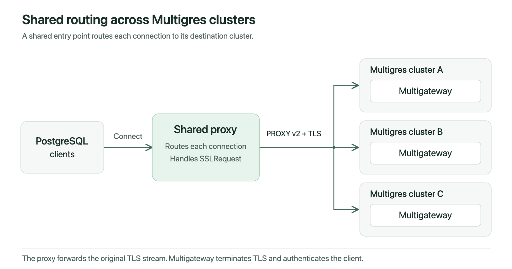
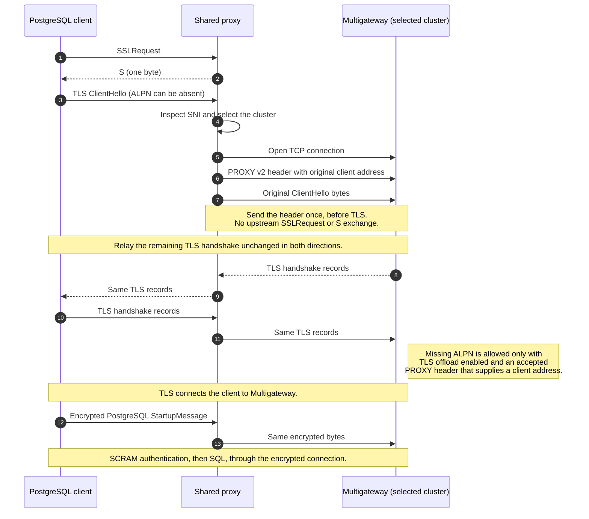

# PostgreSQL proxy connections

Multigateway can accept optional PROXY protocol v2 headers before PostgreSQL negotiation or TLS. These headers carry the original client address across a TCP proxy. The primary and replica listeners use the same configuration.

A shared proxy can provide one entry point for multiple Multigres clusters. It routes each connection to the destination cluster, where Multigateway handles TLS and PostgreSQL authentication.



## Proxy handshake

This sequence shows a client that starts with SSLRequest. Multigateway must have TLS certificates and `--pg-tls-offload` enabled.



SNI is the server hostname in the ClientHello. The proxy uses it to select the destination without terminating TLS. It must preserve all TLS bytes in both directions.

If a preceding proxy supplies a PROXY header, the shared proxy must consume it before PostgreSQL negotiation. It uses the resulting client address in its new upstream header. The upstream header must contain TCP addresses for IPv4 or IPv6. `LOCAL` and `UNSPEC` headers do not permit missing ALPN.

Clients that start directly with TLS skip the SSLRequest/S exchange. If the proxy declines GSS encryption, it replies `N` to GSSENCRequest before processing SSLRequest.

## Configuration

By default, Multigateway accepts PROXY headers from any TCP peer and relies on network access controls for trust. Use this mode when the network restricts access to trusted proxies and clients.

The optional `--pg-trusted-proxy-cidrs` flag restricts which TCP peers can send a PROXY header. It accepts a comma-separated list of networks in CIDR notation, which describes an IP address range. When the list is set, Multigateway tests the immediate TCP peer against these ranges before it reads a header.

```sh
multigateway \
  --pg-tls-cert-file=/certs/server.crt \
  --pg-tls-key-file=/certs/server.key \
  --pg-tls-offload
```

To restrict proxy peers, add `--pg-trusted-proxy-cidrs=10.0.0.10/32,fd00::10/128` with the addresses of your proxies. Any accepted peer can claim another client address through a PROXY header. Without a CIDR restriction, network access controls determine which peers can make that claim.

`--pg-tls-offload` permits TLS without ALPN, the protocol name in the TLS handshake, after a trusted header supplies a client address. Use it when a proxy answers SSLRequest and forwards the TLS bytes directly. The flag requires TLS certificates. Proxy CIDRs are optional, and TLS offload remains disabled by default. A conflicting ALPN value remains invalid.

PROXY v2 does not say whether a proxy answered SSLRequest. The exception therefore covers both direct and negotiated clients forwarded by a trusted proxy. Keep this mode on an endpoint dedicated to PostgreSQL traffic.

Clients without a PROXY header retain their existing behavior. They can send a normal SSLRequest or a permitted plaintext startup. Direct TLS without a header still requires `postgresql` ALPN. Valid `LOCAL` headers retain the TCP peer address and do not enable the ALPN exception. `PROXY` headers with an `UNSPEC` address family are rejected.

Multigateway uses [pires/go-proxyproto](https://github.com/pires/go-proxyproto) to decode headers, as [Traefik does](https://github.com/traefik/traefik/blob/e237cc4e64db8a6a97c8f9e49d4a7718e3f77422/pkg/server/server_entrypoint_tcp.go#L464). Multigateway reads through its existing startup buffer so that the authentication deadline covers the header, TLS handshake, and login.

The parser accepts TCP addresses for IPv4 and IPv6. It limits the address block and optional metadata to 4 KiB, excluding the fixed 16-byte header. For address headers, it validates optional metadata fields but does not use them for authentication. Undefined address-family values, malformed headers, and untrusted headers close the connection without a plaintext PostgreSQL reply.

After a valid address header, `Conn.RemoteAddr()` returns the original client IP and port, including after TLS starts. Authentication logs include this address in `client_addr`. This change does not add IP allowlists or automatic bans.

The equivalent environment variables are `MT_PG_TRUSTED_PROXY_CIDRS` and `MT_PG_TLS_OFFLOAD`. Use command-line flags for the comma-separated CIDR list. The [PROXY protocol specification](https://www.haproxy.org/download/2.9/doc/proxy-protocol.txt) defines the header format and trust model.
